# Pokémon Plus

> 发布包仅保留最近两次，见[发布目录](dist/README.md)。旧版历史记录中的动画模板及安装包下载已清理，原始素材保留在 assets。

ESP32-S3-Touch-LCD-1.85B 圆屏电子宠物，ESP-IDF 5.5.3 + LVGL 9.5.0。


## v0.34.6 · 属性关系图形

属性与咕噜球图标向外移动，中央以更舒展的双向箭头表示当前招式的克制／减伤／免疫；采用3px实心像素箭杆、填充箭头、深色描边及明暗层次，以双箭头、分段和盾牌区分，命中时点亮，相克反馈不再显示文字。所有共用战斗与Web同步，原战斗数值保持。详见[规则与验收](docs/BATTLE-RELATIONS-V0346.md)。已按用户授权刷入设备，保留存档；启动、资源与RTC重启恢复校验通过。

## v0.34.5 · 战斗属性图标

历练、八馆、野生与五神兽挑战均显示当前上场宠物的属性图标：己方血条右上、敌方血条左上，双属性并排，换宠立即更新。原生和Web同步，18类图标使用当前形态数据。详见[规则与验收](docs/BATTLE-TYPES-V0345.md)。已生成同版固件／资源包，本次未刷设备。

## v0.34.4 · 战斗免疫提示

属性免疫时，在攻击命中后于受击宠物上方显示“免疫”，支持双方及道馆／野生／历练。原生与Web同步，战斗数值和存档保持。已完成自动测试、画面与固件包验证，未刷设备。详见[验证记录](docs/BATTLE-IMMUNITY-V0344.md)。保留v0.34.3商店“购买{商品名}x1”提示。

## v0.34.2 · 历练与旅行完成衔接

两项都完成后，历练成长提示结束会接着显示旅行确认；满级无升级也能继续提醒，长按从历练返回不再误暂缓旅行。旅行奖励仍需点击领取且只发一次。详见[修复与验证](docs/COMPLETION-QUEUE-V0342.md)。本次未刷设备。

## v0.34.1 · 历练内容扩充

场景页去掉上方繁荣度文字；六张历练地图每景24–28种宠物，覆盖146种普通形态，并排除连续重复对手。新增36条环境事件与歇脚／树果／清洁／嬉戏四类小事件，金币及物品概率不变，不发额外经验。详见[扩充规则](docs/TRAINING-V0341.md)。

## v0.34.0 · 轻养成数值

场景按不同宠物图鉴形态数免费解锁；历练仅选择家园内伙伴，经验逐场战斗结算。五项状态分别影响经验、出战与续航，医院仅恢复健康；野生遭遇提升至400–700步，并增加场景活跃20分钟保底。金币、照料价格、掉落、计步与旅行收益同步调整，旧存档自动迁移v17。

完整数值与门槛见 [数值规则](docs/BALANCE-V0340.md)，初始诊断见 [审计与规划](docs/BALANCE-REDESIGN-2026-10-28.md)。以每天2–3次轻度游玩、约3–4周培养八馆主力为目标，实际进度取决于配队和补给。本轮交付代码与安装包，未刷设备。

第13景「神树镜湖」已接入：天蓝色神树根缠祭坛，蓝叶落水泛起涟漪；宠物可绕到树后被遮挡，走到前方完整显露，Web同步。


## v0.33.17 · 每日点击额度

每只伙伴每天可通过点击互动获得20次奖励，用完后点击不再触发奖励、动画或提示；次日恢复。次数随个体保存，换宠、进化、重启不重置，BOOT批量互动共用额度。Web同步，旧存档自动迁移。

## v0.32.0 · APP 与换场景界面

APP改为两列卡片、6＋4分页，统一深蓝绿配色。换场景使用居中缩略图卡片，区分使用中、已解锁与未解锁，保留名称和价格，减少描述文字。网页同步真实LVGL画面与热点。[预览](docs/screenshots/menu-design-preview.png) · [界面约定](docs/MENU_UI.md)。

## v0.31.2 · 发现藏品文案

弹框标题改为「发现藏品」，以「{宠物名字}找到了藏品」说明发现者，按钮为「收下藏品」。网页入口同步为「宠物发现」，沿用居中对称布局。

## v0.31.1 · 赠礼弹框居中对称

球体与圆扣位于圆屏中心，宠物、名字、藏品、品质和按钮沿同一中轴排列，两侧像素星芒与分隔线成对对称。统一珊瑚红、暖白、墨绿配色；五种品质实图见[对照](docs/screenshots/gift-quality-sheet.png)。

## v0.31.0 · 伙伴赠礼

场景内清醒健康的宠物每累计活动10分钟，有5%机会找到一件未拥有藏品赠送给主人。咕噜球弹框展示宠物、藏品与品质；集齐后停止，离线和熄屏不累计。礼物及待确认提示保存到v11存档，自动迁移旧版。详见[赠礼规则](docs/PET_GIFTS.md)与[界面](docs/screenshots/gift-pending.png)。

## v0.30.1 · 神兽挑战界面

五种属性配色、八徽章进度、锁定／胜利状态、奖励蛋展示、金框伙伴选择与挑战收获已统一美化。复用现有精灵和静态图元；原玩法与v10存档保持。共享原生效果见[神兽界面](docs/screenshots/legend-design-preview.png)。

## v0.30.0 · 神兽挑战

集齐八枚道馆徽章后，从APP第二页进入五只神兽挑战。三圣鸟、超梦与梦幻不再参与普通孵蛋或场景遭遇；胜利获得对应蛋存入背包，手动放入庭院后摇动启动，2–4小时孵化，也可使用孵化药剂。旧伙伴保留，存档升级v10。规则与分类来源见[神兽挑战](docs/LEGENDARY_CHALLENGES.md)。

## 星空山丘流星与枫叶（2026-10-24 更正）

按用户更正，星空山丘使用带渐淡拖尾的流星与闪烁星点，流星只在天空划过；庭院恢复绿色风叶。秋日木林保留红橙金色像素枫叶。Web与完整固件包同步，未刷机。

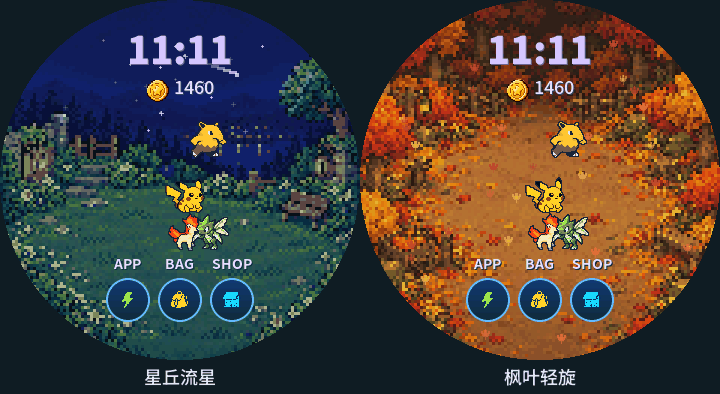

## v0.29.3 · 全场景动效优化

其余10景同步优化：花瓣、落叶与萤火铺开到整个圆屏，水面波纹与闪光覆盖完整海水，晶簇分色闪烁，流星渐入渐出，风沙与云雾往返飘动。水纹／晶芒仍贴合原画材质，特效位于时间、金币、宠物和按钮下方。Web及完整包同步，未刷机。

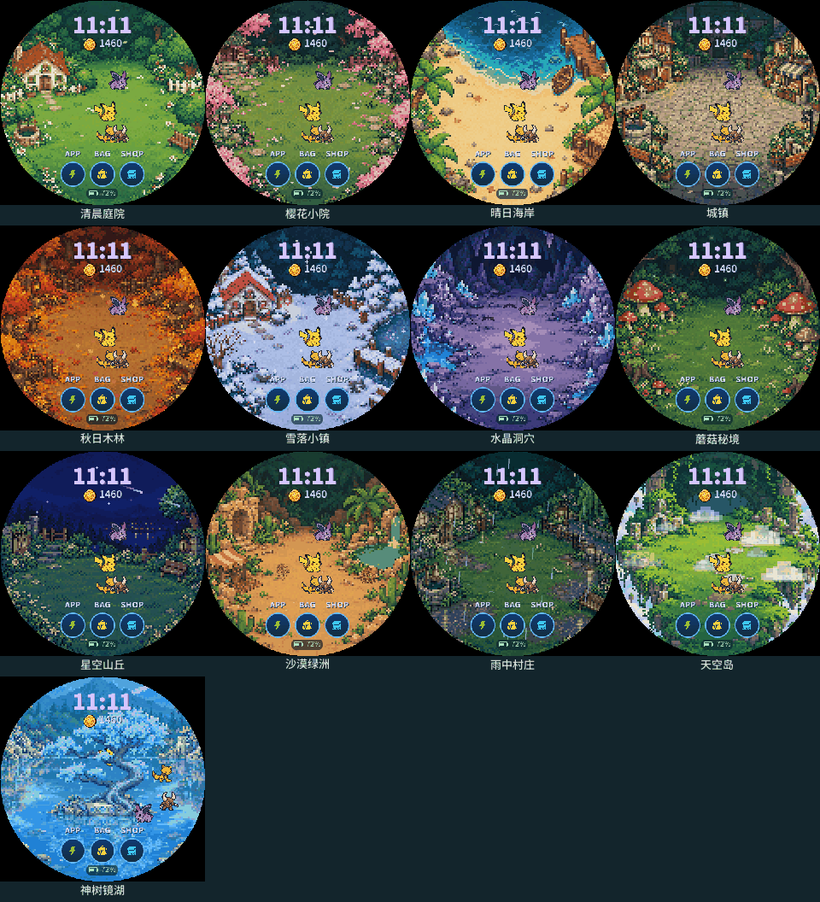

## v0.29.2 · 全屏雨雪

雨丝和雪花覆盖整个圆形画面，从顶部一直落到底部，两侧及时间／金币、按钮背后也有自然飘落。文字与宠物保持在特效上层，屏幕外沿保留安全留白。Web及完整刷机包同步，未刷机。

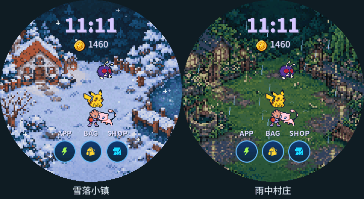

## v0.29.1 · 场景特效增强

12个场景增加持续可见的基础动效，雪花／雨丝／花瓣更清楚，水面与晶簇亮部增强，云雾覆盖两侧云海。随机天气仍会渐强渐弱，时间、金币和底部按钮保持清晰。Web及完整刷机包同步，未刷机。

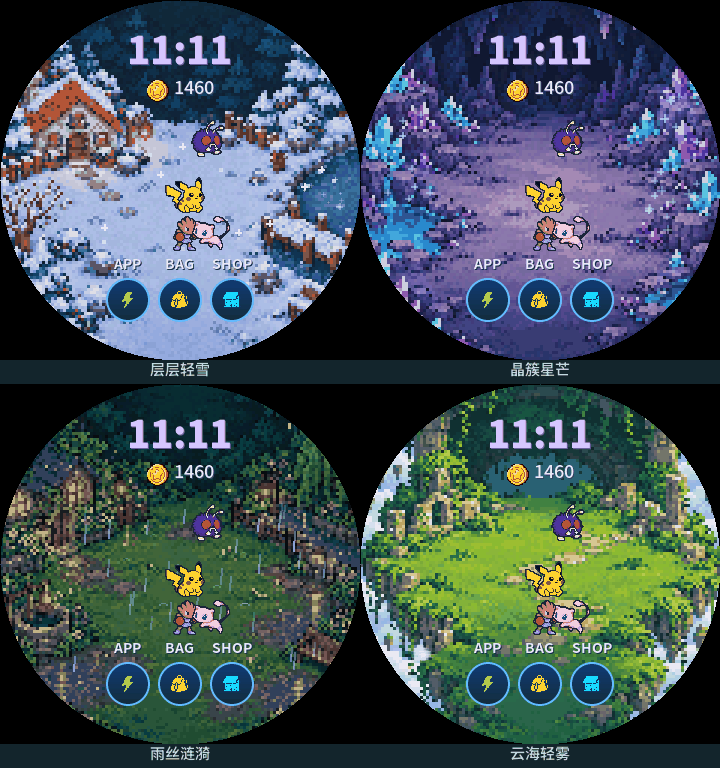

## v0.27.2 · 右侧浮动提示

临时提示统一显示在屏幕右侧，宽度随文字变化，长句自动换行，缓缓上移后淡出。切换页面继续显示，连续触发重新计时。Web同步；完整包已更新，未刷机。


## v0.27.0 · 常青道馆／坂木

深红徽章解锁第八馆：尼多后、尼多王、钻角犀兽均为Lv.40。首通绿色徽章＋1350金币，实际出场伙伴各540经验；重赛360金币，每胜稀有以上藏品（15%／50%／35%）。八馆左右循环，展馆完整展示八枚徽章。

绿瓦道馆坐落于常青森林边缘，坂木与三宠站在门前石砌广场；通关隐藏队伍并显示大地碎岩主题“击败”。“开始战斗”后选择三位伙伴和出场顺序，等级上限40、存档v8保持。固件已构建校验，未刷机。

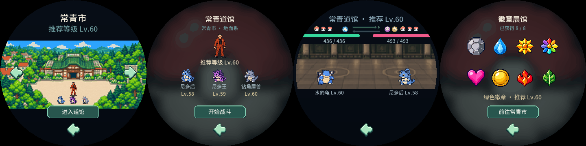

## v0.26.0 · 红莲道馆／夏伯

金色徽章解锁第七馆：九尾Lv.39、烈焰马Lv.39、风速狗Lv.40。首通深红徽章＋1200金币，实际出场伙伴各480经验；重赛320金币，每胜稀有以上藏品（20%／50%／30%）。七座道馆左右循环，第七枚徽章进入展馆第二行。

红莲岛采用火山、海岸、研究所与红瓦玄武岩道馆；夏伯与三宠站在干燥广场，通关隐藏并显示火焰街机“击败”图。等级上限40、存档v8保持。固件包仅构建校验，未刷机。

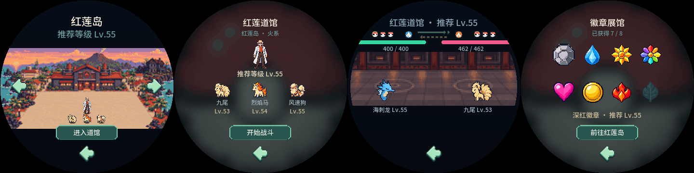

## v0.23.0 · 玉虹道馆／莉佳

橙色徽章解锁第四馆：蔓藤怪Lv.28、大食花Lv.29、霸王花Lv.30。首通彩虹徽章＋750金币，实际出场伙伴各300经验，每胜稀有以上藏品。四城左右循环切换，展馆开放第四枚徽章。

花木庭院、绿色温室场地与藤叶街机“击败”图已接入；人物大于宠物，按脚底落在门前空地，通关后隐藏。沿用“开始战斗 → 选择三只伙伴”，最高40级，存档v8，未刷机。

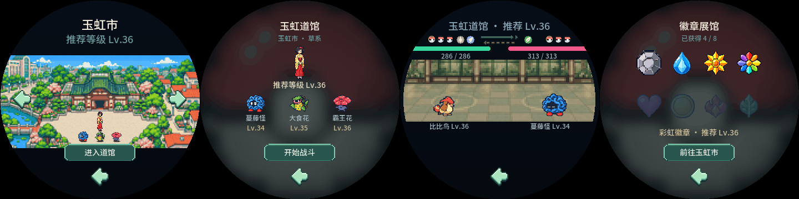

## v0.22.9 · 道馆人物与宠物比例

馆主放大到32／34px，宠物缩小到14／18px，突出人物。三馆分别按台阶／道路／码头校准每个角色的脚底，避开建筑、水面和护栏；未通关显示队伍，通关后隐藏。

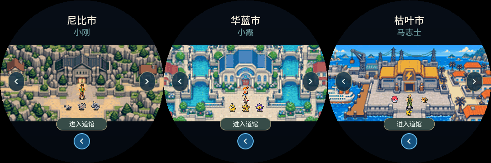

## v0.22.5 · 门口守馆队伍

未通关道馆：馆主和三只守馆宝可梦站在门前，点击角色也能进入道馆。通关后他们隐藏，显示对应主题的“击败”标记；三馆分别独立判断。

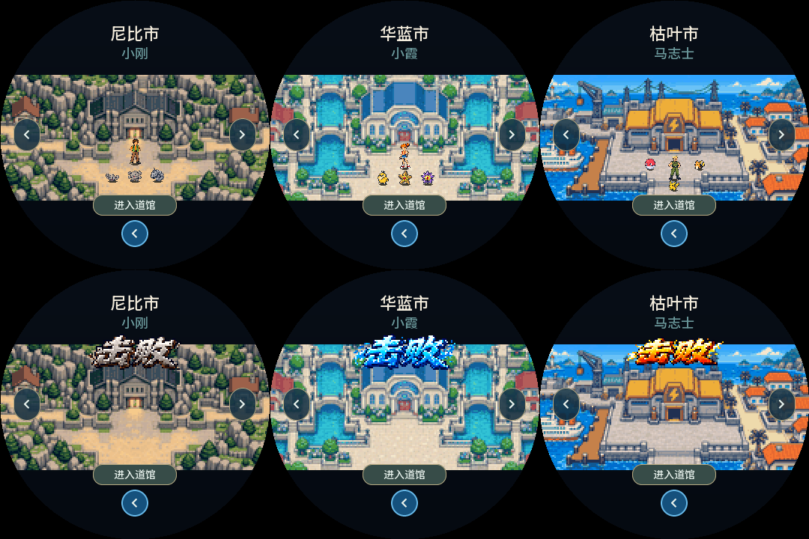

## v0.22.8 · 宠物信息美化

头像、名字和经验合为小卡片，五项照料用彩色图标和短进度条显示；底部统一换宠、返回和添伙伴图标。长按先看信息，换好伙伴立即返回场景。Web同步，未刷入设备。

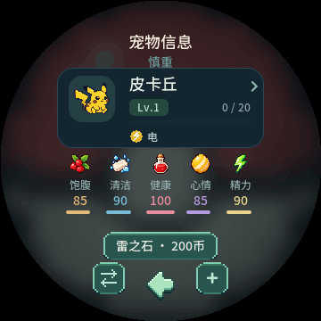

## v0.22.6 · 宠物信息与换宠

长按场景宠物先查看信息，点击双向箭头图标选择替换伙伴，选好后立即返回场景。Web与完整固件包同步，未刷入设备。

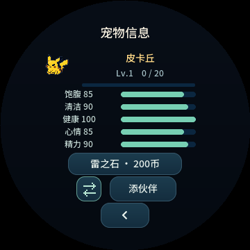

## v0.22.5 · 逐景特效精修

12个场景分别调整：樱花花瓣、三层雪花、细雨和落地涟漪、林间萤光、天空流星、沙路风沙、云海薄雾。海面波光和水晶星芒跟随原画位置；树冠边缘更干净，云海循环更平顺。时间、金币和底部按钮保持清晰。


[Web预览](http://127.0.0.1:4173/web/) · [无需SD卡的完整固件包](dist/pokemon-plus-all-in-one.zip)。Web点击「播放特效」可逐景查看；本轮未刷入设备。

## v0.22.3 · 城市与馆主标题

地图主标题显示当前城市：尼比市／华蓝市／枯叶市，22px；下一行仅显示对应馆主小刚／小霞／马志士，18px。切换道馆同步更新，两行居中，与主题“击败”标记保持间距。


## v0.22.2 · 道馆主题通关标记

通关后，道馆建筑上方显示街机格斗风格的“击败”图片：尼比为碎裂岩石灰、华蓝为水蓝浪花、枯叶为金黄闪电。左右侧箭头可循环切换三馆；未通关场馆不显示标记。


Web“预览已击败”可查看对应画面；设备按各馆已获得的徽章自动显示。当前136形态／68家庭、最高40级、存档v8。完整固件包已更新，未刷入设备。

## v0.22.2 · 场景动起来

进入庭院就能看到轻微的局部动画：树冠与棕榈叶轻摆、水面缓流、水晶晶面闪光、蘑菇微光、星点闪烁、天空岛云海轻移。房屋、道路、树干、时间和金币保持固定。12个场景各用自己的绘画区域，原有随机天气继续叠加。

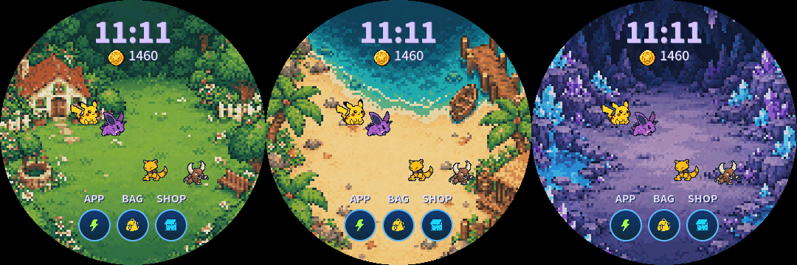

[Web预览](http://127.0.0.1:4173/web/) · [无需SD卡的完整固件包](dist/pokemon-plus-all-in-one.zip)。Web遵循系统“减少动态效果”，主动播放特效时可预览。此版本未刷入设备。

## v0.22.0 · 枯叶道馆 · 马志士

蓝色徽章解锁第三馆。华蓝市地图点“下一馆”到枯叶港口，中央电系道馆、客轮、码头与民居铺满圆屏两侧。马志士居中；“开始战斗”进入三宠选择，按点击顺序出场。

霹雳电球Lv22／皮卡丘Lv23／雷丘Lv24。地面免疫电击，水／飞行怕电，草／电抵抗电击。首通600金币＋橙色徽章，再战160；获胜的实际出场伙伴各240XP＋稀有以上藏品（55%／35%／10%），惜败各60XP。APP展馆可查看前三枚徽章，等级上限40，存档仍v8。

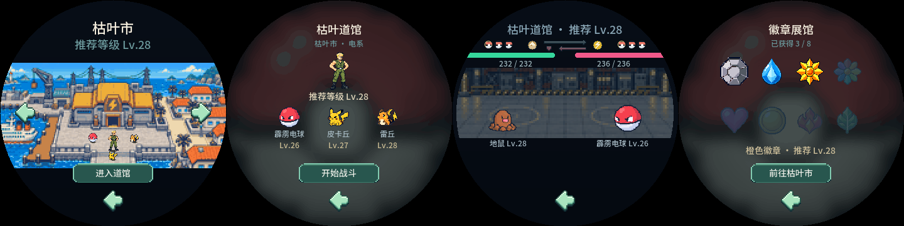

[完整道馆规则](docs/GYMS.md) · [固件包](dist/pokemon-plus-all-in-one.zip) · [网页预览](http://127.0.0.1:4173/web/)

## 华蓝道馆 · 小霞

获得灰色徽章后，在APP道馆地图点击“下一馆”进入华蓝市。运河、石桥和中央水系道馆延展至圆屏边缘；小霞居中，点击“开始战斗”后继续选择三只伙伴。

可达鸭Lv16、海星星Lv17、宝石海星Lv18，三宠接力与阵亡灰球沿用第一馆。首通450金币与蓝色徽章，重赛120金币；胜利时实际出场伙伴各180XP，并获得稀有以上藏品（65%稀有／28%史诗／7%传说）。惜败出场各45XP。两馆首通分别记录，展馆显示两枚徽章，最高40级。

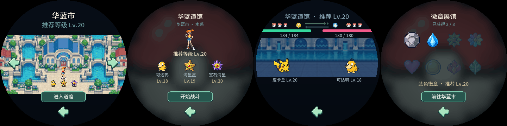

完整规则见[道馆文档](docs/GYMS.md)。Web为共享固件画面与预设编队预览；设备中可自行选择出场伙伴。

## v0.20.3 · 尼比道馆

地图现为延展到圆屏两侧的尼比市场景，中央突出岩石道馆，左右连接山岩、民居与街道；点击建筑或下方入口进入挑战。详情页小刚居中，只保留地点、属性、对手队伍和挑战入口。

APP → 道馆 → 地图进入尼比市 → 自选三只伙伴，按选择顺序接力挑战小刚。小拳石Lv.10、隆隆石Lv.11、大岩蛇Lv.12，血条上方三颗精灵球随阵亡变灰。推荐草／水伙伴Lv.12–14。

首通300金币＋灰色徽章，再战80金币；每次胜利给实际出场伙伴各120经验和一件稀有以上藏品（稀有75%／史诗20%／传说5%）。APP第九格为徽章展馆。当前132形态／67家庭均可参战。

按道馆需求统一最高40级，钻角犀兽门槛42→40；存档v7迁移旧版，保留形态、收藏和永久不进化选择。本文下方历史版本的100级说明已被本条替代。

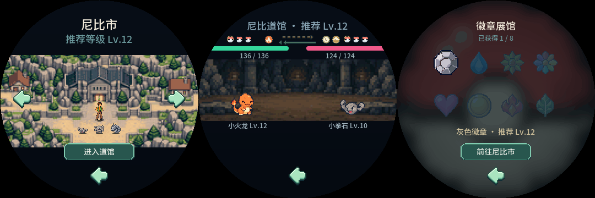

[完整规则与数值](docs/GYMS.md) · [共享固件网页预览](http://127.0.0.1:4173/web/) · [固件包](dist/pokemon-plus-all-in-one.zip) · [验证记录](docs/VALIDATION.md)

核心、共享LVGL交互、圆屏边缘、资源驻留、浏览器桌面／手机及ESP-IDF构建与镜像校验通过；未刷机。网页展示预设编队的共享固件画面，实际编队与奖励由固件实现。

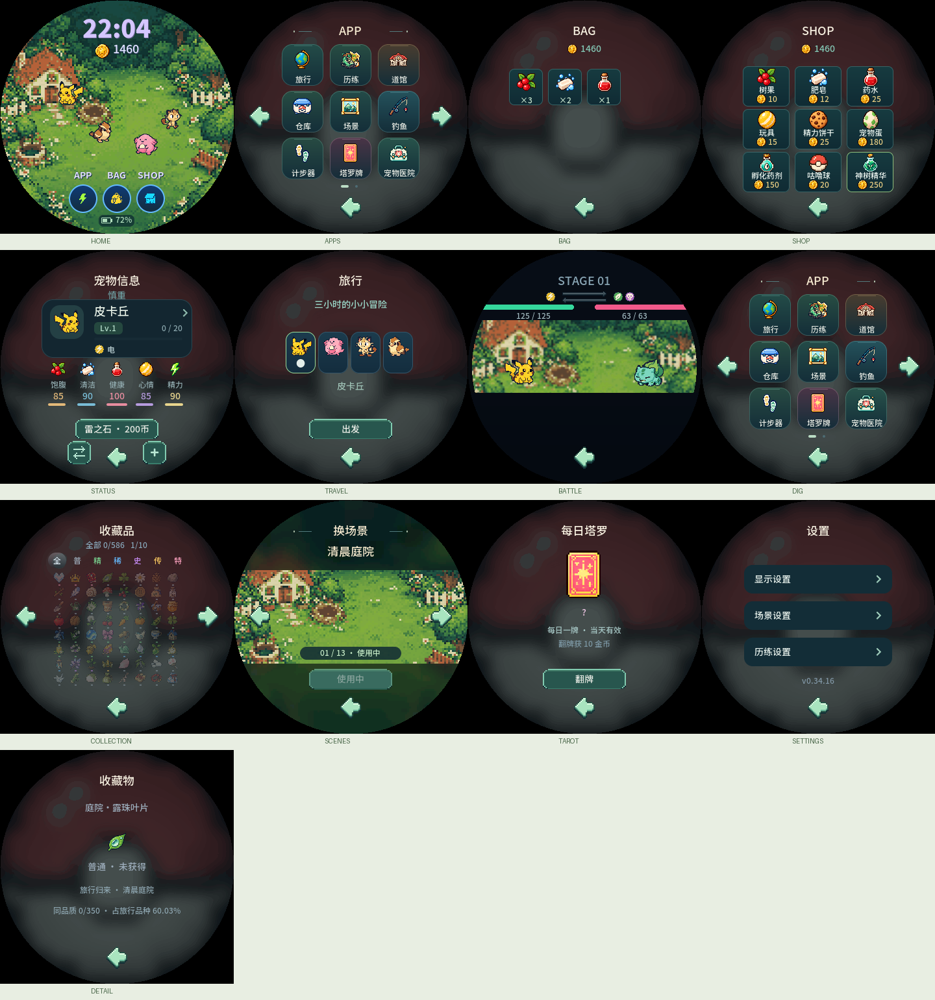

## v0.18.0 · 107–116全套接入

艾比郎至墨海马十只完成六动作×八帧与左右朝向，接入Web和固件。116形态、55家庭、61次进化、220技能；115套完整模板，025保留旧24槽位。109在35级进化110、111在42级进化112，等级上限同步100；116等待117资源。永久拒绝与纯净之心保持。

[Web资源工坊](http://127.0.0.1:4173/web/) · [十只动作包](dist/107-116-animation-templates.zip) · [全部115套模板](dist/001-116-animation-templates.zip) · [验收记录](docs/GEN1-107-116-STATUS.md) · [固件包](dist/pokemon-plus-all-in-one.zip)

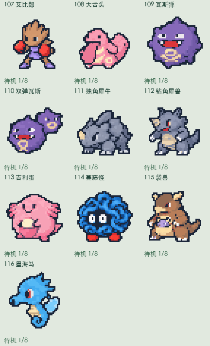

12493张BIN/12,320,452字节，分区/NVS和原生Flash零拷贝保持。已构建验证，未刷机。下一117。

## v0.17.0 · 097–106全套接入

引梦貘人至飞腿郎十只均已完成六动作×八帧和左右朝向，接入Web与固件。共106形态、47家庭、59次进化、188技能；105套完整动作，025保留原24槽位。进化链在Web同排显示，永久不进化与唯一纯净之心规则保持。

[Web资源工坊](http://127.0.0.1:4173/web/) · [十只完整动作包](dist/097-106-animation-templates.zip) · [全部105套模板](dist/001-106-animation-templates.zip) · [本批验收记录](docs/GEN1-097-106-STATUS.md) · [固件包](dist/pokemon-plus-all-in-one.zip)

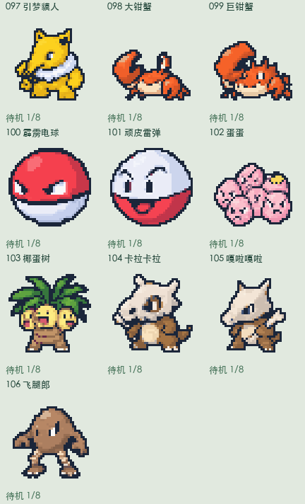

11523张BIN/11,459,692字节；透明边原生无损裁切保留48px逻辑画布、像素和Flash零拷贝，分区不变。已构建校验，未刷机。

## v0.16.0 · 087–096全套接入

白海狮至催眠貘十只完成六动作×八个真实姿态及左右朝向，已接入Web和共享固件。96形态、42家庭、54次进化、168技能；95套完整模板，025保留旧24槽位。

[Web资源工坊](http://127.0.0.1:4173/web/) · [十只动作包](dist/087-096-animation-templates.zip) · [全部95套模板](dist/001-096-animation-templates.zip) · [本批记录](docs/GEN1-087-096-STATUS.md) · [固件包](dist/pokemon-plus-all-in-one.zip)

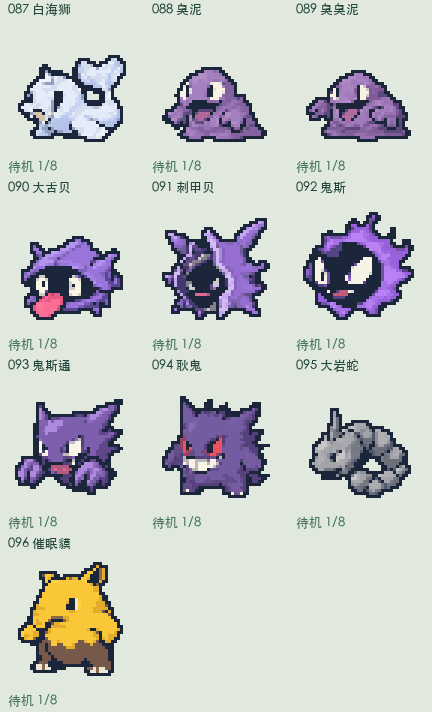

10553张BIN/15,065,236字节。应用预留1.5MiB、assets0x190000/0xE70000，NVS保持；更新须使用同版分区表/应用/图片。已构建校验，未刷机。097–106已于v0.17.0全部接入，见上方发布记录。

## v0.15.0 · 077–086全套接入

小火马至小海狮十只完成六动作×八个真实姿态及左右朝向，已接入Web和固件。现在86形态、37家庭、148技能、49次进化；85套完整模板，025保留旧24槽位。

077在40级、079在37级、081在30级、084在31级进化；086的Lv.34→087等待下一批资源。永久不进化与纯净之心赠礼保持。

[Web资源工坊](http://127.0.0.1:4173/web/) · [十只动作包](dist/077-086-animation-templates.zip) · [全部85套模板](dist/001-086-animation-templates.zip) · [本批记录](docs/GEN1-077-086-STATUS.md) · [固件包](dist/pokemon-plus-all-in-one.zip)

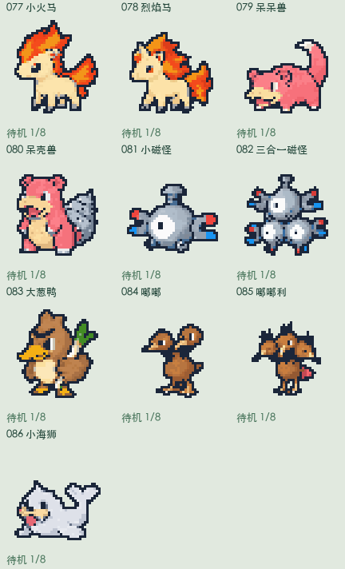

9583 BIN / 13,768,396字节，宠物帧仍原生Flash零拷贝。应用预留2MiB，图片分区0x210000/0xDF0000，NVS不动，更新时须使用同版分区表/应用/图片。v0.15.0已编译打包，本轮未刷机；下一批087。

## v0.14.0 · 067–076全套接入

豪力至隆隆岩十只均完成六动作×八个真实完整身体姿态与左右朝向，接入Web和固件。现在76形态、31家庭、124技能、45次进化；75套完整模板，025保留旧24槽位。

腕力Lv28→豪力→联系之绳→怪力；喇叭芽Lv21→口呆花→叶之石→大食花；玛瑙水母Lv30→毒刺水母；小拳石Lv25→隆隆石→联系之绳→隆隆岩。道具200金币，永久不进化与纯净之心保持。

[Web资源工坊](http://127.0.0.1:4173/web/) · [十只动作包](dist/067-076-animation-templates.zip) · [全部75套模板](dist/001-076-animation-templates.zip) · [本批记录](docs/GEN1-067-076-STATUS.md) · [固件包](dist/pokemon-plus-all-in-one.zip)

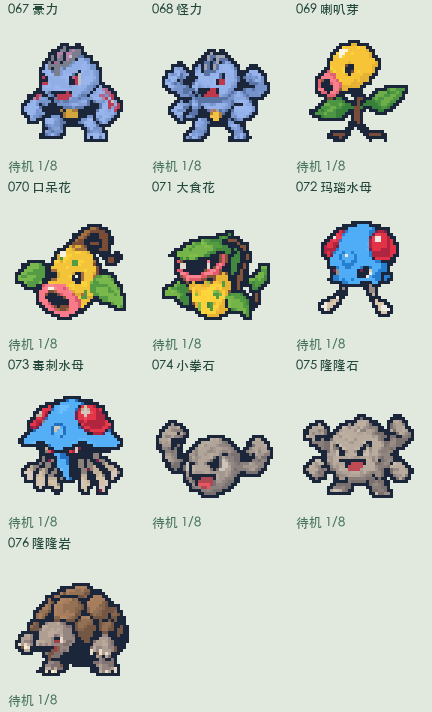

8613 BIN / 12,471,556字节，现有16MiB Flash分区布局不动，宠物仍原生Flash零拷贝。v0.14.0已构建打包并通过电脑和Web验证，本轮未刷机。下一批从077开始。

## v0.13.0 · 057–066全套接入

火暴猴至腕力十只均完成六动作×八个独立完整身体姿态及左右朝向，接入Web与固件。现在66形态、28家庭、112技能、38次进化；65套完整模板，025保留原24槽位。新增火/水之石及联系之绳进化，永久不进化与纯净之心保持。

[Web资源工坊](http://127.0.0.1:4173/web/) · [十只动作包](dist/057-066-animation-templates.zip) · [全部65套模板](dist/001-066-animation-templates.zip) · [本批记录](docs/GEN1-057-066-STATUS.md) · [固件包](dist/pokemon-plus-all-in-one.zip)

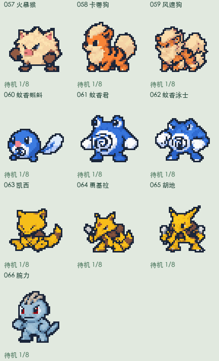

7643张BIN / 11,174,716字节，图片分区扩至0xBF0000（起点0x410000），应用/NVS偏移保持；宠物帧仍Flash原生零拷贝。v0.13.0已编译打包并通过电脑验证，本轮未刷机。

此前067–076基础形象完成、动作服务失败的记录已由上方v0.14.0完整接入状态替代；原始失败日志仍保留。

## v0.12.0 · 047–056全套接入

派拉斯特、毛球、摩鲁蛾、地鼠、三地鼠、喵喵、猫老大、可达鸭、哥达鸭、猴怪均完成六动作×八个独立姿态及左右朝向，接入庭院、照料、睡眠、旅行、挑战、头像和图鉴。现在56形态、24家庭、96技能、32次进化；025保留原24槽位，其余55套为48个独立姿态。

046→047为24级；048→049为31级；050→051为26级；052→053为28级；054→055为33级。056→057等下一批资源完成后开放。永久不进化与纯净之心规则保持。

[Web资源工坊](http://127.0.0.1:4173/web/) · [十只动作包](dist/047-056-animation-templates.zip) · [全部55套模板](dist/001-056-animation-templates.zip) · [本批记录](docs/GEN1-047-056-STATUS.md) · [固件包](dist/pokemon-plus-all-in-one.zip)

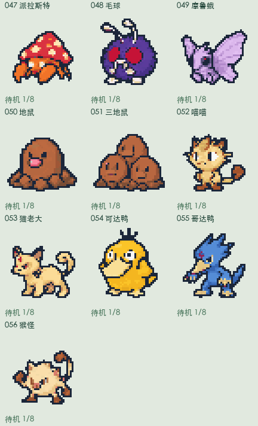

6673张BIN / 9,877,876字节，维持10MiB图片分区。46张静态背景采用启动一次无损解压，全部宠物帧继续Flash原生零拷贝。存档v6、五只上场与十一只候补保持。固件v0.12.0已构建打包，本轮未刷机；启动ROM解压与PSRAM占用尚待设备验证。

## v0.11.0 · 037–046全套接入

六尾、九尾、胖丁、胖可丁、超音蝠、大嘴蝠、走路草、臭臭花、霸王花、派拉斯均完成六动作×八帧及左右朝向，接入庭院、投喂、休息、旅行、挑战、头像和图鉴。现在共46形态、19家庭、76技能、27次进化；025继续保留原24槽位，其余45套均为48个独立姿态。

037用火之石、039用月之石；041在22级、043在21级进化，044再用叶之石。石头均200金币，可免费选择永久不进化并获纯净之心。046的24级进化等待047资源生成后开放。

[Web资源工坊](http://127.0.0.1:4173/web/) · [十只动作包](dist/037-046-animation-templates.zip) · [全部45套模板](dist/001-046-animation-templates.zip) · [本批记录](docs/GEN1-037-046-STATUS.md) · [固件包](dist/pokemon-plus-all-in-one.zip)

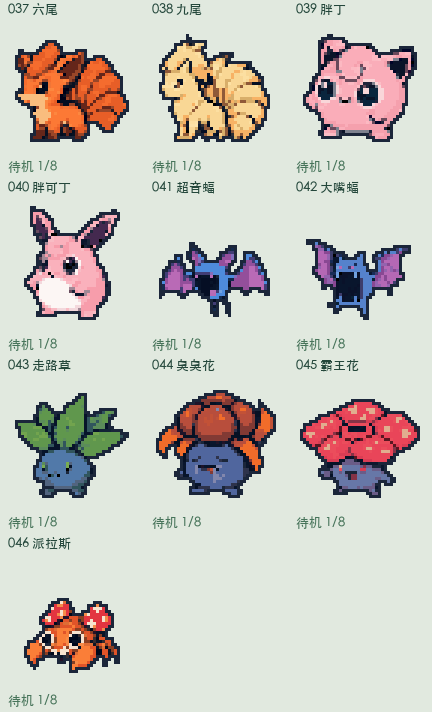

5703张BIN / 9,886,872字节，仍使用10MiB图片分区。仅12张静态庭院背景启动时一次性无损解压到PSRAM，全部宠物帧继续Flash零拷贝。v0.11.0已构建打包，本轮未刷机。

## v0.10.0 · 028–036全套接入

028穿山王至036皮可西九只均完成六动作×八帧，左右朝向、闭眼睡眠、庭院/投喂/旅行/挑战/头像/图鉴同步接入。现在共36形态、14家庭、56技能、22条进化转换；025保留原24个位移槽位，其他35只均为48个独立姿态。

027在22级进化028；029/032在16级进化，再用200金币月之石进入最终形态；035使用月之石进化036。每只均可永久不进化并获纯净之心，金币不足也能选择保持原样。

[Web资源工坊](http://127.0.0.1:4173/web/) · [九只动作包](dist/028-036-animation-templates.zip) · [全部35套模板](dist/001-036-animation-templates.zip) · [进化设定](docs/EVOLUTION.md) · [固件包](dist/pokemon-plus-all-in-one.zip)

4733张BIN/9,869,780字节，维持10MiB资源分区和PSRAM描述符/Flash零拷贝，未修改硬件参数或存档v6布局。核心与Web状态测试、36形态/56技能共享LVGL交互、22条进化双分支、原始圆屏外沿、资源逐像素和固件镜像回读验证通过。固件已构建打包，本轮未刷入设备。

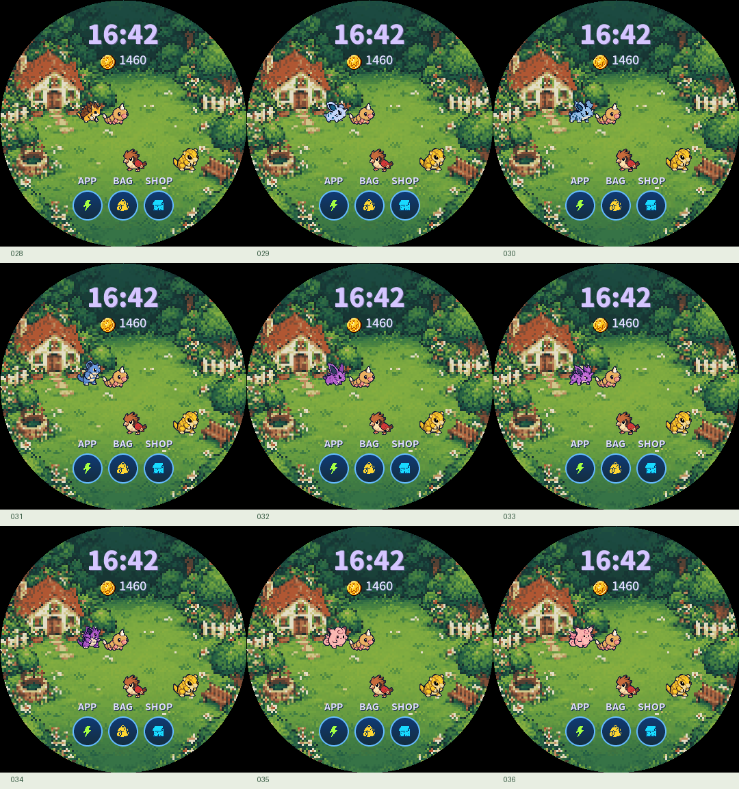

## v0.9.3 · 伙伴与每日功能

BOOT长按一秒摸摸所有在场伙伴；宠物状态页支持候补替换/添加上场。增加每日随机已解锁场景开关，移除挖宝入口，8种塔罗分别提供当天有效的养成、旅行或战斗增益。存档v5自动迁移并保留v1–v4原key、个体等级与进化选择。

[操作与增益](docs/DAILY-COMPANIONS.md) · [共享UI截图](docs/screenshots/daily-features.png)

该功能保留在当前v0.10.0包中；本轮未刷机。

## 随机旅行风景

新增10套MobiIoT独立像素背景，每次出发随机抵达，单次旅途中、返程和收获保持同一目的地；重开页面或恢复存档不换景。每套有对应活动和奇遇，Web提供全部十套预览。说明与总览见[旅行风景](docs/TRAVEL.md)。本轮未刷机。

## 收藏品品质与独立图片

583件旅行收藏已全部补齐中文名称与独立像素图，另有特殊赠礼「纯净之心」。按品种数分为普通350（60%）、精良146（25%）、稀有58（10%）、史诗23（4%）、传说6（1%）；整数采用最大余数法。旅行优先从未拥有藏品中等概率抽取，583件集齐后只发金币和经验。固件与Web支持品质筛选、收藏详情与拥有进度，原存档v4与收藏ID保持。

[收藏设定](docs/COLLECTION.md) · [共享圆屏截图](docs/screenshots/collection-ui.png) · [图片预览](docs/screenshots/collection-art.png)

## v0.9.1 · 真机显示内存修复

修复大量资源占满内部RAM导致LCD DMA发送失败及白条：图片描述符放入PSRAM、帧表直接引用描述符、资源查找改为二分。真机启动UI由8.3秒降至1.5秒，58秒日志无DMA失败或看门狗；已保留存档刷入设备，用户确认白条已消失、画面正常。

## v0.9.0 · 进化选择与纯净之心

达到进化条件后先选择“进化”或“保持原样 · 永久”。选择保持后，这一只伙伴永久停止进化（包括雷之石），继续正常升级养成；不扣金币，并获得唯一收藏品「纯净之心」。同种的其他伙伴不受影响。

动画文案：“成长，也可以是守护最初的自己。”进化分支显示“每一次成长，都有你的陪伴。”收藏页首格可查看礼物。Web 宠物详情提供满级试玩，按单只伙伴保存，与设备存档独立。

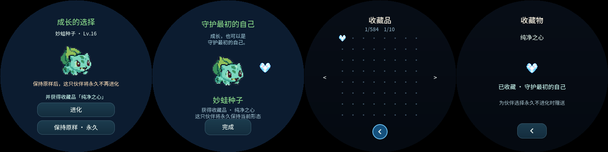

存档升级为v4，自动迁移v1/v2/v3并保留原key；永久选择和礼物一起立即请求保存。583个旅行收藏位置保持原编号，新增特殊收藏ID583，总计584个位置。固件已更新打包，暂不刷机。

## v0.8.0 · 019–027接入与雷之石进化

[资源工坊](http://127.0.0.1:4173/web/#animation) · [进化设定](docs/EVOLUTION.md) · [固件包](dist/pokemon-plus-all-in-one.zip) · [批次状态](docs/GEN1-019-027-STATUS.md)

019–024、026–027新增8只完整动作，每只六动作×八帧，包含左右朝向、闭眼睡眠和逐帧时长，庭院、投喂、睡眠、旅行、挑战、头像与图鉴同步接入。027→028待后续批次，当前不触发。025皮卡丘新版请求两轮均连续6次HTTP400，仍保留原24位移槽位，不能当作48姿态完成。

进化新增019→020（20级）、021→022（20级）、023→024（22级）及025→026（状态页雷之石，200金币）。普通/即孵蛋加入新初始家庭；现11家庭、27形态、44技能，初选001/004/007、五只容量和存档v3布局保持。

[019–027已完成模板（8只，排除025）](dist/019-027-animation-templates.zip) · [001–027已完成模板（26只，排除025）](dist/001-027-animation-templates.zip) · [本批实际LVGL画面](docs/screenshots/forms-019-027.png)

2683张BIN内置图包为7,702,300字节，保持10MiB分区；宠物及场景/缩略图/旅行条采用I4/I8无损索引，逐RGBA验证。启动常驻描述符、45秒巡游无额外图片读取。固件已构建并验证，用户暂不刷机要求继续有效。

## 0.6.0 计步与孵蛋


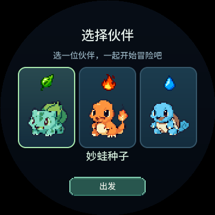

首次从001妙蛙种子、004小火龙、007杰尼龟选择一只伙伴；选定后存档。旧版单只默认皮卡丘会进入选择，多宠存档保留。宠物48px画布/约38px主体，扩大二维巡游范围、支持水平转向，气泡跟随且仅短暂低频显示。背包与商店返回庭院。

圆屏顶部和底部增加留白，APP标签与下一行图标分开，Web同步新版坐标。

主庭院换回最初的草地与房屋背景，提亮6%。APP新增计步器，每100步自动奖励金币和每只宠物经验，1000/5000步提升档位。蛋随机2–4小时，旧长计时迁移后最多剩4小时。真机图片改为Flash索引映射，避免逐文件查找阻塞；桌面预览继续使用内存缓存。固件与资源仍合为一个刷机包，不需要SD卡。真实触摸手感仍需上板体验确认。

## 0.4.1 内置资源版

现有游戏资源随固件写入板载 Flash，不需要 SD 卡。完整刷机包见 [pokemon-plus-all-in-one.zip](dist/pokemon-plus-all-in-one.zip)，单文件 [pokemon-plus-all-in-one.bin](dist/firmware-all-in-one/pokemon-plus-all-in-one.bin) 刷入地址为 **0x0**。仅适用于微雪 ESP32-S3-Touch-LCD-1.85B（16MB Flash）。详见 [刷机说明](dist/firmware-all-in-one/README.txt)。

单文件刷写会覆盖 NVS 空隙并清除原存档和 Wi-Fi 配置；需要保留时使用包内 `flash_args` 分区刷写，同样无需 SD 卡。001/004/007用于首次选择卡片，001–009全部形态已接入场景动作。

## 0.4.0

去除外扩黑边，细化内页；每只固定四技能轮换，接入 MobiIoT 四元素图片特效。小火龙达到 Lv.16 / Lv.36 自动弹出进化动画，新形态图片待补。详见 [进化模板](docs/EVOLUTION.md) 与 [技能资料](docs/MOVES.md)。

## 运行

资源网站（默认仅本机访问）：

```sh
python3 tools/serve.py
# http://127.0.0.1:4173/web/
```

电脑预览（macOS 需要 CMake、SDL2、Clang）：

```sh
sh tools/preview.sh --demo
```

Windows 64位免安装包：解压 `dist/pokemon-plus-windows-x64.zip`，双击 `PokemonPlus.exe`，保留同目录的 `resources` 和 `SDL2.dll`。与命令行预览相同，关闭后进度重置。macOS/Linux可用 `python3 tools/build_windows.py` 交叉编译并重新打包，需要 CMake、Ninja、MinGW-w64；脚本校验 SDL2 下载、资源清单与 ZIP 哈希，不构建固件。

模拟器游戏画面固定按圆形裁切、等比缩放。桌面可拖动窗口边缘调整大小；圆屏下方 `- / +` 调整50%–100%，点击百分比恢复100%。四个快捷按钮为「+100步／摇一摇／+1小时／回庭院」，与原有键盘操作共用游戏接口。

Android 14+：安装 `dist/pokemon-plus-android14.apk`，包含ARM64与x86_64，同样提供圆屏缩放和快捷按钮。`python3 tools/build_android.py` 使用本地Android SDK／NDK和JDK生成签名APK；构建及验证记录见 [模拟器应用](docs/SIMULATOR_APPS.md)。Android也沿用内存预览，关闭进程后重置。

`--demo` 显示四只宠物；不带此参数从一只皮卡丘开始。预览使用鼠标真实按下/释放；长按一秒查看状态。`K` 模拟100步、`S` 模拟摇晃，空格推进一小时，`Esc` 回庭院，`0`～`9` 切换对应页面。预览存档仅在内存；设备存档写 NVS。预览与固件共用游戏模型和界面，不能用电脑流畅度判断实机性能。

固件：在完整的 ESP-IDF 5.5.3 环境中：

```sh
idf.py set-target esp32s3
sh tools/build_firmware.sh
# 需要连接设备时：idf.py -p /dev/cu.usbmodem... flash monitor
```

本轮未烧录或擦除设备。当前成品为 `dist/pokemon-plus-all-in-one.zip`，偏移来自 IDF 生成文件。旧 `pokemon-plus-firmware.zip` 是0.4.0依赖SD卡的历史包，请勿与新版混用。`sdcard/` 仍作为资源构建与电脑预览的源目录，硬件运行无需插卡。

首次电脑预览优先使用本项目 `managed_components/lvgl__lvgl`；不存在时 CMake 从 LVGL 官方下载固定的 v9.5.0。不要切回其他工程的 LVGL 版本。

## 本轮界面与动画

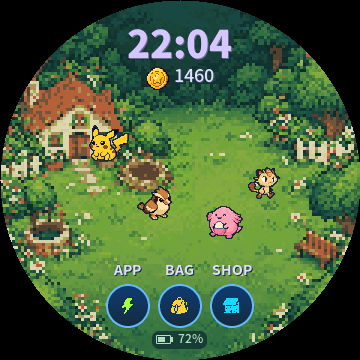

主屏按参考照片调整为浅紫粗体时间、金币行、蓝色圆形按钮和绿/黄/青图标。宠物使用 20×20 原生网格，最近邻放大到 40×40；轮廓最多 36 像素，减少细碎纹理并加深描边。

001–009为6组×8帧、按动作逐帧时长更新；025保留6组×4帧、125ms更新：待机、行走、开心、进食、睡眠、攻击。摸头触发开心，投喂先走近后进食，旅行与挑战也播放对应动作。网站与固件共用资源和动作规格 `assets/pet-animation.json`。

001–009每只使用MobiIoT参考原画生成48个独立姿态；025仍由原生PNG进行整体整数位移，保持原比例和色板。完整48帧模板见assets/templates/pet-animation-48；不可用身体拉伸或肢体切割补帧。

## 挑战与排版更新（0.3.0）

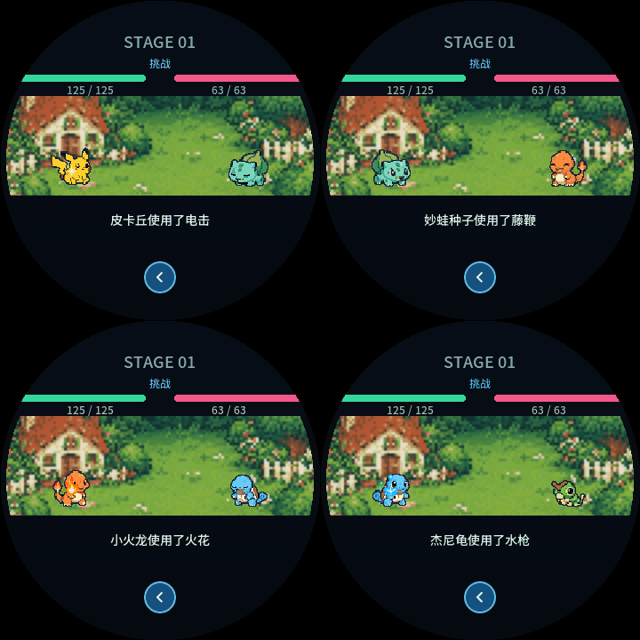

标题和技能18px、正文14px、辅助信息12px；菜单图标24px、宠物40px，保留圆屏边缘空间。挑战页使用独立的名字/血条/场景/技能区域，技能名常显、出手时标注我方或对方，取消挤在底部的战斗长句。

技能特效按资料描述实现为锯齿电流、双藤抽打、小火焰和连续水流，固定图元池每40ms更新。每轮先我方后对方，命中时显示伤害并扣减对应血条，胜败结算等待动画完成。存档结构未改动。麻痹、灼伤、属性克制等正作完整机制暂未实现。

## 当前可玩内容

- 轻点：心情 +2、金币 +1；长按一秒：状态条。
- 商店和背包：树果、肥皂、药水、玩具、精力饼干、宠物蛋。道具落地后，宠物四秒内走近并使用。
- 孵蛋：随机2–4小时，至少摇晃一次，优先未拥有的物种，最多五只。当前接入四个物种；四种齐全后可孵出重复伙伴。
- 旅行：至少两只才能出发，一只旅行三小时，期间事件、金币，归来领取收藏物。
- 挑战：选宠、当前招式与属性、双方交替特效、命中伤害/血条、最后一击后结算。皮卡丘电击、妙蛙种子藤鞭、小火龙火花、杰尼龟水枪，名称与视觉来源见 `docs/MOVES.md`。
- 挖宝：每天六次、三点生命，摇晃推进，可提前收取。
- 收藏：584件独立名称/图片、8×8网格、七品质页签与动态分页。普通/精良/稀有/史诗/传说350/146/58/23/6件，特殊「纯净之心」1件。
- 场景：十二张实际生成的场景，清晨庭院免费，其余购买后切换。
- 塔罗：每日一张，翻牌奖励十金币。
- 自主行为：本地规则驱动的走动、气泡、状态衰减、睡觉恢复；未接入语言模型。

文档没有给出的价格、战斗公式、消耗频率和挖宝概率属于首版游戏设计，可调整，详见 `docs/GAME-RULES.md`。不把这些值当成照片中的原始规则。

## 时间与按键

设备时间初始显示 `--:--`。可在 `idf.py menuconfig → Pokemon Plus` 配置 Wi-Fi 后使用 SNTP；也可通过 USB 串口发送 `TIME <Unix秒数>\n`。`tools/sync_time.py` 可发送当前电脑时间。时区固定为北京时间。

每日操作需有效日期。上次存档包含可信时间、重启后重新校时，才补算离线进度（上限七天）；未校时时不猜断电时长。板载 RTC 暂未启用。

原板 POWER 直接控制电源管理芯片，不能做软件短按。当前 BOOT 单击切换背光，并禁用熄屏时的触控；长按 BOOT 的自定义动作与触摸唤醒未实现。电池百分比、音频、OTA 更新和实机功耗/触摸/摇晃调校仍待上板验证。

## 开发与校验

```sh
sh tools/test.sh                         # ASan/UBSan 核心规则 + BSP 哈希
python3 tools/validate_assets.py          # 图片二进制头/透明度/哈希/字库/清单
sh tools/preview.sh --smoke               # 真实指针事件回归
python3 tools/capture_preview.py          # 所有页面截图
python3 tools/prepare_assets.py           # 重建网站清单和 SD 包，需要 Pillow
```

- `core/`：无硬件依赖的游戏状态和规则。
- `main/game_ui.c`：固件与电脑共用圆屏界面，图片按目标尺寸预处理，不在设备实时缩放。
- `main/app_main.c`：官方 BSP、内置只读索引资源、IMU、USB 校时、Wi-Fi SNTP、NVS 存档。
- `assets/source/`：MobiIoT 生成原图；`assets/prompts/`：实际提示词；`assets/templates/pet.txt`：后续宠物统一模板。
- `assets/atlas-layout.json`：实测裁切边界。模型没有严格生成等分格，禁止重新盲目等分。
- `web/`：资源网站；图片实际来自 `sdcard/pokemon-plus`，与设备共用清单。
- `docs/HARDWARE.md`：硬件依据与无法确认的部分。
- `docs/VALIDATION.md`：本轮验证和限制。

依赖中保留上游许可证；字体 Noto Sans SC 使用 SIL OFL。AI 图像按本机 MobiIoT 服务生成，仓库不包含凭证。
