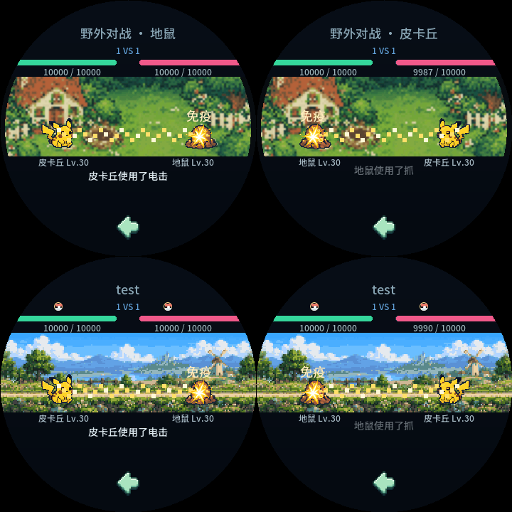
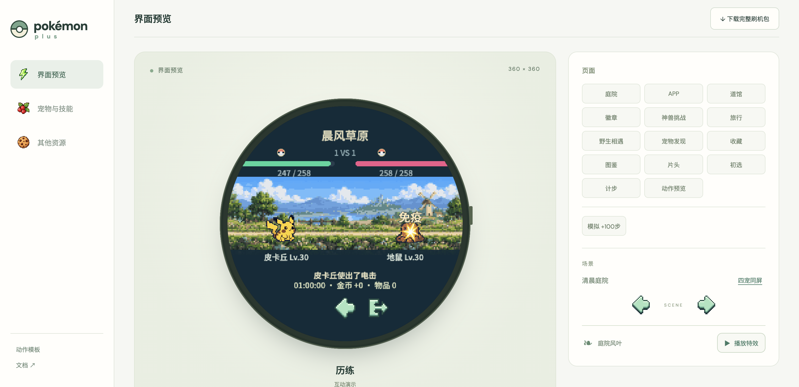
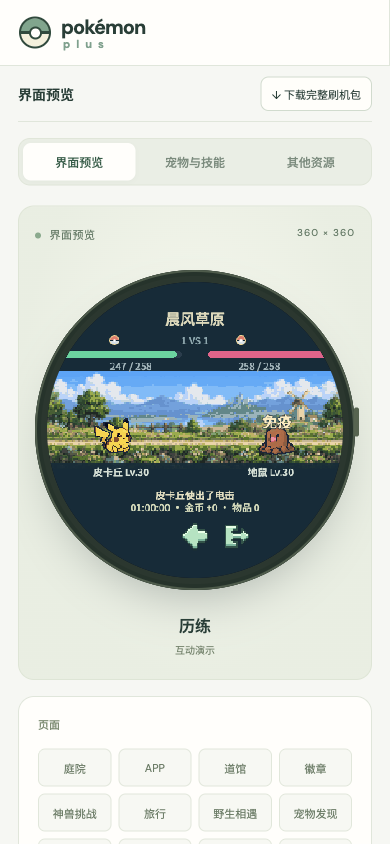

# v0.34.4 战斗免疫提示

当有威力的攻击因属性相克为0而没有伤害时，在命中后于受击宠物上方显示“免疫”。双方共用原生战斗渲染，覆盖道馆、野生与历练；Web互动历练同步。

提示复用伤害标签，18px浅金文字和深色描边，沿原伤害文字位置上浮；每次攻击内部时钟360–799ms显示（战斗时钟以2.25倍推进），施法前与800ms起隐藏。零威力技能、普通减伤不显示免疫。复用标签且每回合记录判定，不增加对象、定时器或图片读取。补充字体“疫”，未改伤害／经验／金币和存档结构。

## 验证

- `sh tools/test.sh`：核心ASan／UBSan及全量Web测试通过。
- `SDL_VIDEODRIVER=dummy SDL_RENDER_DRIVER=software preview/build/pokemon_plus --assets sdcard/pokemon-plus --immunity-smoke`：36例通过；电→地面、一般→幽灵、地面→飞行、格斗→幽灵、幽灵→一般、毒→钢、龙→妖精，双方、野生及历练；另有零威力与减伤对照。检查命中前／命中／消失、HP、字体、实际标签、无读取和无状态变更。
- `node tests/test_battle_immunity.mjs`：18次实际Web回合，覆盖双方、同组相克、边界、入场屏蔽与存档恢复。
- 原始渲染器在新增的实际“免疫”标签断言失败，新版通过，日志分别为`build/immunity-before.log`和`build/immunity-native.log`。
- 原生全量`--smoke`通过，151形态及实际指针交互通过。
- Tabbit实际页面固定测试战斗在命中时刻：桌面与390×844均可见正确目标上方的“免疫”；窄屏开启减少动态效果仍显示，无横向溢出、无脚本或资源错误，后台历练返回正常。测试数据位于独立4193端口，与默认4173隔离。
- ESP-IDF固件编译、16073张内置图片逐项读回、PPASSET3版本匹配、分区／NVS布局／SHA256／ZIP验证通过。应用分区余量11%。包与证据见dist及`build/immunity-release-checks.json`。

## 画面

原生双方／野生／历练测试夹具：

Web实际历练：

本次未刷入设备，不将电脑验证视为实机验收。Windows／Android未重建。
