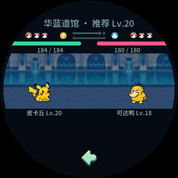
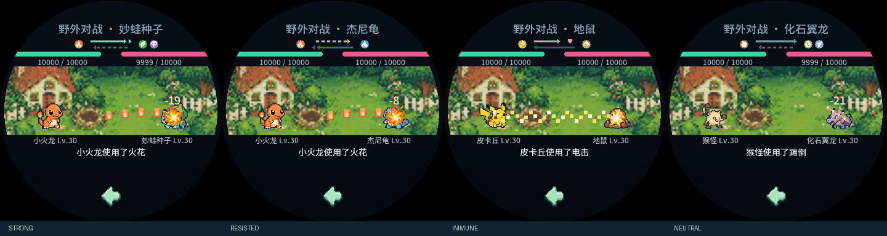
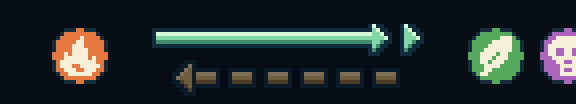

# v0.34.6 属性关系图形与留白

双方属性和咕噜球队伍图标对称外移，中央保留72px的双向箭头。克制用薄荷绿双箭头，减伤用暖金分段箭头，免疫用粉红箭头及盾牌，普通用灰蓝单箭头。箭杆为3px实心，箭头填充，四周带1px深蓝外描边；顶部高光、主体颜色和底部暗面构成立体像素造型。上行表示己方攻击对手，下行表示对手攻击己方；当前攻击施法时加亮、命中时最亮。没有“克制／减伤／免疫”文字，也移除了中央VS；原伤害数字、名字和战斗叙述保留。

## 判定与布局

- 按本回合实际招式与对方全部属性计算，直接复用core的相克结果；Web使用从core导出的相同属性表与曲线。单倍／半倍／双倍等分别沿用实际100／65／150等紧凑曲线分类，双重克制200、双属性抵消100、免疫0。零威力招式隐藏对应方向。
- 每回合及换宠时刷新，未出手的方向保持低亮预览，换宠重新按下一招式更新。箭头代表当前招式，不据宠物本体图标推断其所有招式都具有同一相克关系。
- 图标y64、己方右端x136（单属性x120，双属性x102和120），敌方x224、242；球队伍标记x52、68、84／264、280、296，16px间距。箭头区域x144–215、y63–81，宽72px，血条与宠物位置保持。
- tools/battle_relation.py生成相同LVGL／Canvas像素条带和颜色；固定一个72×19px绘图对象，无逐帧图片读取／动态对象／新增定时器。缓存与UI探针按实际数值范围使用uint8_t，ESP内部DRAM链接通过。未修改游戏伤害、经济、经验、技能和存档。

## 验证

- 原生`--immunity-smoke`现48次真实回合：野生／历练、双方，七类免疫、零威力、减伤、克制、双重克制及双属性抵消；验证实际HP、命中时机、关系分类和亮度、没有免疫／VS标签、无额外读图／状态变更。
- Web`tests/test_battle_immunity.mjs`现24次真实回合，验证图形分类、箭头区域、命中亮度、入场不点亮、没有文本绘制、保存恢复与零状态改动。151形态双侧映射／坐标／圆屏安全检查通过。
- 原生151形态双方与实际双→单属性换宠，道馆真实指针接力通过；图形逻辑的全量核心ASan／UBSan、Web及原生smoke通过。最终实心箭头、盾牌、72×19布局与紧凑缓存再次编译，原生48回合／151形态及Web专项通过。
- 当前八馆、五神兽、野生、历练、旧挑战16张静图及14段GIF重新导出并目视。所有战斗共用同一原生绘图逻辑，Web当前预览同步。
- 实心样式修改前，Tabbit固定时钟的独立4195端口夹具验证实际Web历练；桌面／390px减少动态效果均无相克文字、脚本或资源错误，无横溢出，返回APP正常。为后台测试页驱动绘制使用页面可见性夹具，未声称真实前台动画或设备FPS验收；测试存储已清理。最终实心样式重新通过同源Canvas的24回合与151形态专项，未重复进行浏览器实页截图。
- ESP-IDF构建／PPASSET3精确版本／16083图逐项读回／分区／NVS布局／SHA256／ZIP验证通过，应用分区余量10%。资源包含同期商店美化新增图，本功能不依赖新增图片。原0.34.5包与manifest逐文件校验保留，发布仅保留两版。证据build/battle-relations-release-checks.json。

## 效果

本次未刷入设备；电脑验证不等于实体屏幕、触摸或实际帧率验收。Windows／Android未重建。

## 设备刷入验收

用户随后授权，已从v0.34.2升级至v0.34.6。仅写应用与同版资源，完整备份及整片写后摘要核验通过，NVS／PHY与应用逐字节读回通过。首启与重启读取v17庭院5只／仓库39只、金币760、总步数10968，16083图、UI和IMU正常，运行I2C／LCD错误0。首次USB重启日志连接中断，经用户重新插拔USB后重做受控重启验收通过。首启UI ready后取当前UTC发送TIME，确认USB校时与RTC写后校验；重启未发送TIME，RTC恢复与主机差0.65秒。串口释放、原USB校时守护恢复。证据build/battle-relations-device-flash-checks.json；未做实体屏幕目视／战斗交互／实际FPS验收。上文“未刷”记录为源码交付时状态。
