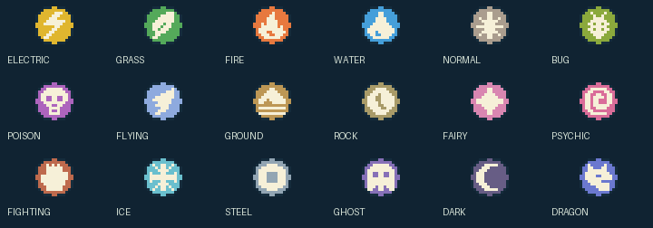
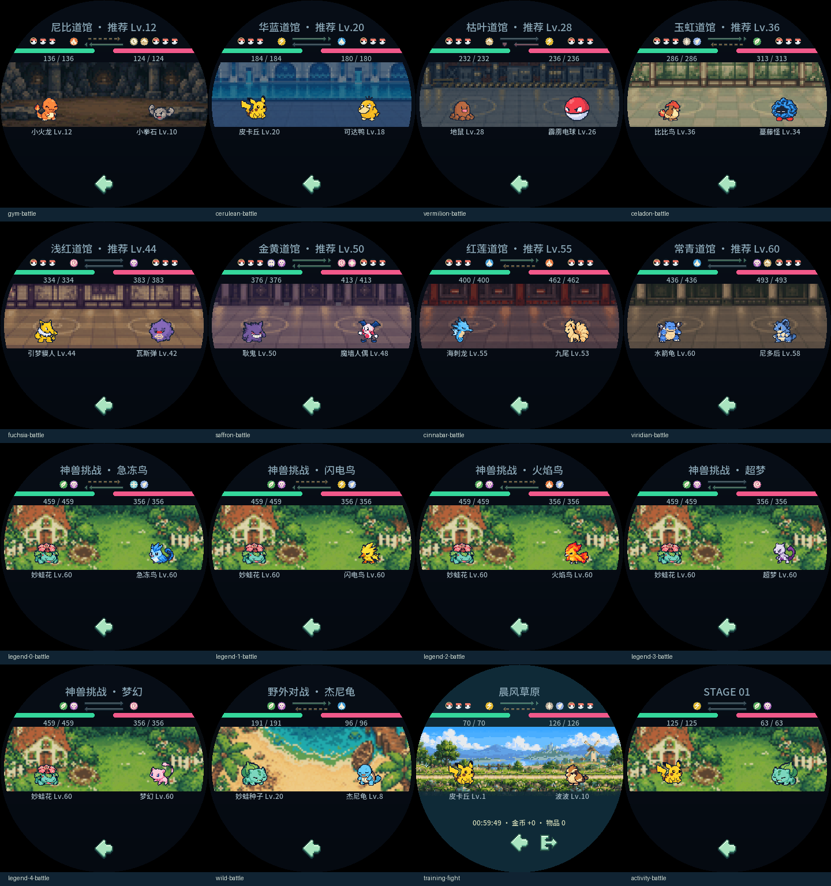
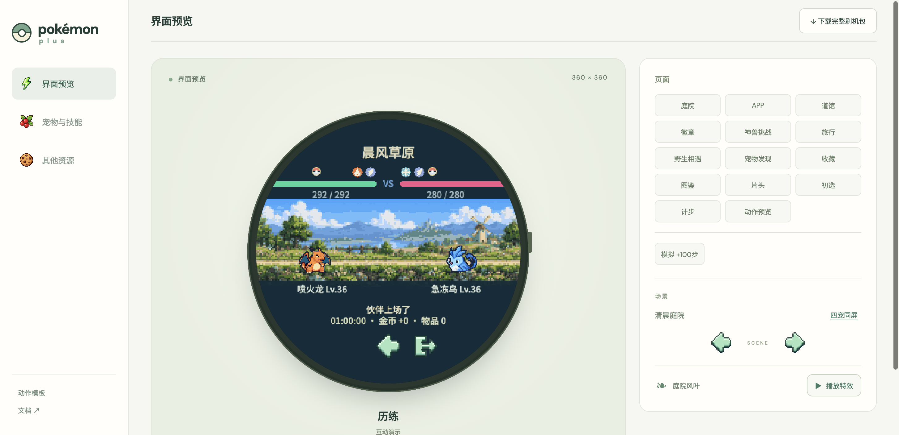
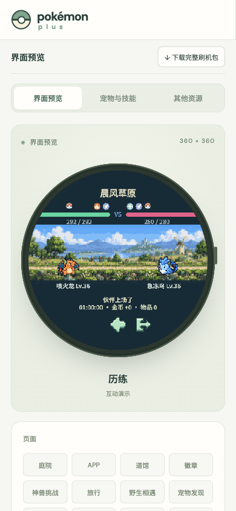

# v0.34.5 战斗属性图标

当前上场宠物的属性显示在己方血条右上、敌方血条左上，双属性并排。属性来自assets/pet-types.json生成的当前形态表，与实际相克判定一致。例如小火龙为火，喷火龙为火／飞行；急冻鸟为冰／飞行，超梦为超能。

## 布局与覆盖

- 属性图标16×16，双图标相距18px；屏幕y64，己方单图x148、双图x130和148，右端对齐血条x164；敌方从x196向右排列。
- 原血条y84、HP数值、标题与宠物位置保持。敌方队伍球从x234开始，VS移入两血条之间的空隙，属性／队伍标记不重叠。
- 覆盖历练、八个道馆、野生、五个神兽和旧挑战。新建战斗与核心接力换宠时刷新，双属性切到单属性隐藏旧第二图标。
- 18种代码像素图标由tools/battle_type_icons.py统一生成LVGL常量像素和Web模块；不依赖外部图像文件，不增加逐帧文件读取。prepare_assets会同步更新。没有修改伤害、技能、经济、经验或存档。

## 验证

- 原生`--battle-types-smoke`：151形态双侧，逐一检查可见LVGL图像的真实像素、位置及数量；入场前后、核心实际接力（喷火龙→小火龙、急冻鸟→超梦）验证旧属性消失，文件读取与游戏状态保持。
- 原生`--gym-smoke`：真实指针选择三宠、双方换宠与返回再进入，检查属性与当前上场宠物一致。
- Web`tests/test_battle_types.mjs`：151形态双侧，权威属性映射、血条对齐、圆屏安全与双→单转换；原18例免疫回归保持。
- 全量`sh tools/test.sh`、原生`--smoke`和`tools/validate_assets.py`通过；未重跑无关硬件验收。
- 16种当前战斗静图及14段战斗GIF由共享LVGL重新导出并目视，八馆／五神兽／野生Web预览与原生一致。
- Tabbit实际Web历练桌面与390×844下显示喷火龙火／飞行、急冻鸟冰／飞行。减少动态效果时仍显示；无横向溢出、脚本或资源错误，返回庭院正常。独立4194端口测试存储已清理。
- ESP-IDF应用与PPASSET3同为0.34.5；16073图逐项读回，分区／NVS布局／SHA256／ZIP验证通过，应用分区余量10%。原0.34.4发布包完整保留、逐文件校验，dist仅保留两版。证据build/battle-types-release-checks.json。

## 画面

本次未刷入设备；电脑检查不代表实体屏幕目视或触摸验收。Windows／Android未重建。
