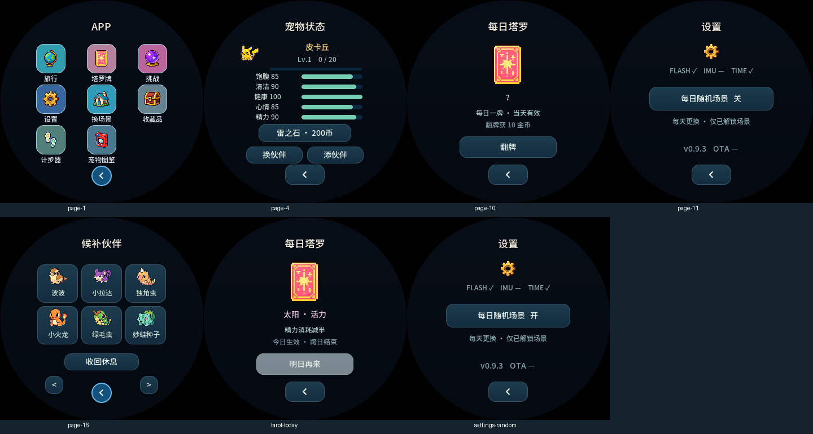

# 伙伴与每日功能

庭院亮屏时，BOOT长按1秒，为场景内每只宠物摸头一次并播放开心动作。旅行中的宠物跳过，持续按住不会重复触发；短按仍控制背光。

长按场景中的宠物进入状态页。“换伙伴”从候补栏选择替换；“添伙伴”填入空的庭院槽位。候补页也可让当前宠物“收回休息”，庭院至少保留1只。庭院最多5只、候补最多11只；满庭院时新孵化宠物进入候补。等级、经验、状态及永久不进化的决定均跟随个体保留，图鉴统计包含候补。旅行、战斗或道具消费中暂不调整阵容。

设置中开启“每日随机场景”后，每天从已解锁场景选一个，有其他场景时避开当前场景。首次开启即时选择；当天重复开关不再重抽，手动选择依然可用。不自动购买场景；等待可靠日期后才能每日切换。

塔罗每天可翻1张，获得10金币，此外开启以下一种当日增益：

| 牌 | 当日效果 |
|---|---|
| 太阳 | 精力消耗减半 |
| 星星 | 每100步额外1经验 |
| 月亮 | 睡眠每10分钟额外恢复2精力 |
| 世界 | 领取旅行奖励时金币增加20% |
| 力量 | 挑战伤害增加20% |
| 恋人 | 每次摸头心情+4、经验+2 |
| 节制 | 道具恢复增加25%，向上取整 |
| 命运 | 每100步额外2金币 |

效果从翻牌后生效，不追溯此前已完成的行动。跨日结束；系统时间无效或倒退时暂停。当天已领取的计步奖励不会重复发放。旅行途中标注的金币为当前预估，实际以领取时有效的增益计算。候补宠物休息，不领取上场宠物的计步经验。

APP暂时移除挖宝入口和页面。存档升级到v5，保留旧key，自动迁移v1–v4；迁移后旧挖宝活动停止，原有宠物/金币/收藏/进化决定保持。

Web同步独立试玩和固件画面预览，与设备NVS分开。8项增益的完整结算在共享C核心中，Web的静态挑战/计步预览不作完整游戏结算。

