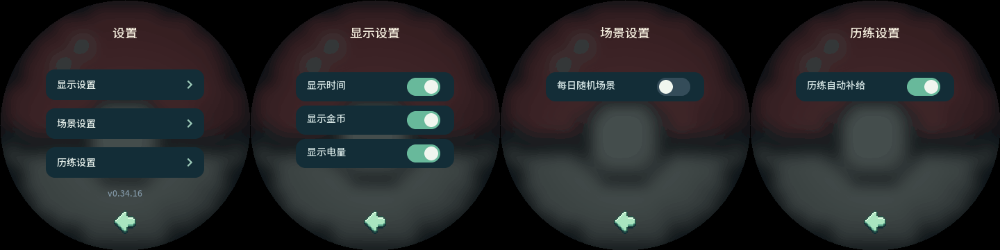

# 设置菜单

当前版本 v0.34.15。APP 第二页进入「设置」，按功能分为两级菜单。

| 一级分类 | 二级选项 |
| --- | --- |
| 显示设置 | 显示时间、显示金币、显示电量 |
| 场景设置 | 每日随机场景 |
| 历练设置 | 历练自动补给 |

分类卡片228×44，位于y100／156／212，右侧显示浅绿色箭头。子菜单开关行228×42，位于y104起、48px间距；标题显示当前分类。底部返回图标保持居中：子菜单回到设置分类，分类页回到APP。离开设置后重新进入始终从分类页开始；界面自动刷新保留当前子菜单。长按BOOT沿原规则返回庭院。版本号只在分类页显示。

各项开关的默认值及保存方式保持：显示三项默认开启，历练自动补给默认关闭；设备沿用原NVS／游戏存档，网页使用自己的本地存储。切换菜单不改变开关或游戏数据，未新增存档字段、图片、字库或计时器。[历练补给规则](TRAINING.md)保持。

验收：真实LVGL分类与子页、全部五开关和八种HUD组合、返回／APP重进／BOOT／自动刷新保持、后台补给、圆屏按钮安全区及零新增图片读取通过。Tabbit桌面1454／390px减少动态、所有分类及开关／持久化重载、零错误及横向溢出通过，临时存储恢复并关闭测试页。原生APP综合测试的旧场景金币价格断言在原版同样失败，夹具改为现有图鉴繁荣度免费解锁后通过，未修改场景逻辑。

应用与PPASSET3资源同版0.34.15，16083图逐项读回／分区／NVS／哈希／ZIP通过，图像载荷与原14一致。证据 [发布检查](../build/settings-menu-release-checks.json)。本轮未刷设备，未做实体屏幕验收，未重建Windows／Android。
