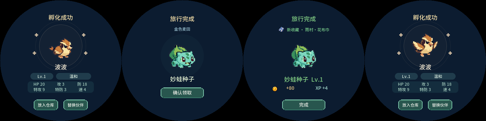

# v0.34.9 旅行完成与孵化提示解锁

旅行到期仍先显示「旅行完成」，点击「确认领取」才领取奖励并让伙伴返程；「完成」回到场景。若此时还有孵化安置选择，旅行领取完后继续显示该宠物的孵化结果。

## 复现与原因

- 孵化成功页或替换伙伴页通过 BOOT 离开后，`hatch_result.active` 原先一直保留。旅行提醒和手动领取都被这一隐藏状态阻止，后续自然孵化的结果也无法展示。
- 旅行中的庭院宠物不能转入仓库，因为移动槽位可能影响旅行者索引。新宠在庭院孵出后，「放入仓库／替换伙伴」会因此等待旅行返程；原先孵化页又禁止旅行弹框，形成互相等待。

## 行为规则

- 离开孵化结果及其替换流程时，只清理安置选择的 UI 状态。核心已经生成的宠物继续留在庭院或仓库，不删除、不重新孵化。
- 孵化结果／孵化替换页属于可以显示旅行完成提示的页面；先处理到期旅行，再回到仍待确认的孵化结果。后台战斗、道具使用、进化及已展开的庭院遭遇／赠礼提示继续保留原有等待规则。
- 自动切到旅行页不丢弃孵化结果。主动 BOOT 离开孵化流程则视为暂不安置，宠物保持当前位置；下一次自然孵化可以正常显示。
- 不改变三小时旅行期限、80金币／出发等级经验条20%／未拥有藏品奖励及存档v17。没有新增定时器、存档字段或帧内资源读取。

## 验证

`sh tools/test_completions.sh` 通过旅行、历练成长、64组双任务完成及23页 BOOT 返回回归。新增五组真实 LVGL 指针流程覆盖孵化页／替换页 BOOT、替换页返回、手动重进旅行、庭院新宠安置互锁及正在替换时旅行到期；断言确认前不发奖、连点不重发、宠物总数保持、后续自然孵化仍可展示。已有「孵化发生在旅行确认／收获动画期间」用例继续通过。

相同新增用例链接原0.34.8 UI时在旅行完成提示断言失败，新版通过：`build/travel-hatch-unlock-baseline.log`、`build/travel-hatch-unlock-final-smoke.log`。完整完成专项记录 `build/travel-return-completions.log`。新增流程的四张截图如下：

Web仍为共享 LVGL 旅行阶段预览，不提供设备的后台任务队列。缓存更新为completionqueue2，APP／设置版本截图同步。Tabbit 1454px桌面及390px减少动态效果下，旅行完成→领取→返回入口可用，无页面脚本／HTTP错误或横向溢出。独立4192测试端口的数据已清理、测试页关闭；清理初次打开Markdown触发浏览器下载而中断，已改用静态HTML页完成清理，不将该次导航计作产品检查通过。

应用／PPASSET3资源同版0.34.9；16083图片逐项回读、分区边界、NVS布局、哈希及ZIP检查通过，原0.34.8整包按原manifest及ZIP哈希归档，dist只保留9／8。证据 `build/travel-hatch-unlock-release-checks.json`。本次未刷设备、未做实体触摸验收，未重建Windows／Android，也未重复无关的核心数值全量测试。

## 随后设备安装验证

用户随后授权刷入v0.34.9，设备44:bd:8d:78:13:e8：完整16MiB备份经设备全片摘要验证，仅写0x10000应用与0x190000同版PPASSET3资源，整片写后校验／应用逐字节回读／NVS及PHY保留通过。首启与重启均正常读取v17庭院5／仓库40、金币477／总步数11421，16083图资源及UI ready正常；IMU ready、运行I2C／LCD错误0。UI就绪后USB校时与RTC写入验证成功，第二次启动不发TIME，RTC恢复与主机差0.223秒。串口释放、原USB校时守护恢复；未做实体屏幕目视或实际旅行领取触摸验收，保留既有GPIO ISR提示。备份backup/2026-10-29_12-39-36_v0349-flash，证据build/travel-hatch-unlock-device-flash-checks.json。上文“本次未刷设备”为源码交付时状态。
