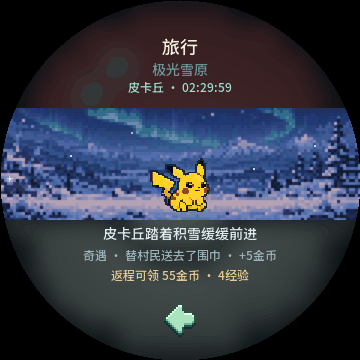

# 旅行动态场景 · v0.34.8

旅行中的十个目的地使用现有360×112画面持续向左滚动，与历练同为40px／秒；25ms移动1px，UI目标每33ms刷新。原图与镜像拼接为720px周期，约18秒回到同一位置，拼接边缘连续。原资源里的圆屏深色边缘已移除，统一由外层圆屏裁切，避免深色楔形跟随背景移动。

| 目的地 | 途中效果 |
| --- | --- |
| 晨雾竹林 | 竹叶轻飘 |
| 碧海沙湾 | 细小海沫 |
| 赤岩峡谷 | 风中尘屑 |
| 极光雪原 | 缓落雪花 |
| 萤火湿地 | 闪烁萤火 |
| 浮云群岛 | 轻薄云丝 |
| 金色麦田 | 金色麦穗 |
| 古树遗迹 | 浅绿飘叶 |
| 熔岩山径 | 上浮火星 |
| 薰衣花丘 | 飞舞蝴蝶 |

背景在现有RGB565画布中保存40320像素输出和80640像素镜像源，总计120960像素，未超出现有129600像素区域。只在入页时解码，帧内两段行拷贝；特效复用一个固定绘图层，不新增计时器、堆分配、资源读取或游戏随机调用。宠物沿用当前活动的走路／观察／休息姿态。灭屏暂停视觉，亮屏继续；离页不干预旅行进度，原旅行时长、奇遇、结算确认与存档v17保持。

原生`--travel-smoke`检查十景逐像素1px位移、两处镜像接缝和18秒周期；600帧局刷对全刷、无新图片读取／RNG／奖励、灭屏暂停恢复及原完整领取与保存流程通过。历练共享画布回归通过。十景三态PNG和共享LVGL的72帧GIF由`tools/capture_travel.py`导出。网页继续使用阶段截图／短循环GIF示例，减少动态效果时显示静图；不是浏览器后台旅行系统。

Tabbit桌面1454px实际可见动画变化、390px静图、完成／收获／旅途中切换通过，零横向溢出／JS或HTTP错误。隔离origin测试存储恢复，scratch关闭、正常finish。源码与固件证据见`build/travel-motion-release-checks.json`。应用与PPASSET3均0.34.8，保留原0.34.7发布包。本次未刷机，33ms为刷新目标，不代表ESP32实测FPS。

