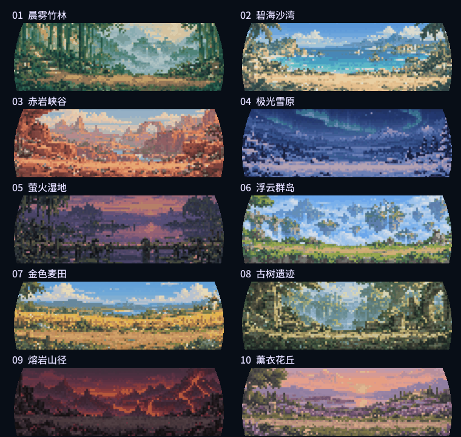

# v0.33.38 旅行完成确认

旅行的显示和结算均以存档中的 `travel_end` 与 `seconds` 判断。到期后，在亮屏且界面可安全切换时自动显示「旅行完成」，必须点击「确认领取」才一次发放金币、经验和藏品，随后播放结算动画，点击「完成」返回庭院。提示本身不修改存档、RNG或奖励，等待与重复点击均不重复发放。未处理的野外遭遇、待捕捉伙伴、旧胜负收据和待确认赠礼保持原状，不阻挡已完成的旅行；完成后仍可继续处理它们。

真正进行中的战斗、道具使用、进化、孵化揭晓、命名、替换／放生确认、钓鱼及已经显示的选择弹窗暂缓提醒。旅行页显示等待原因，条件解除后自动提示；灭屏期间到期，亮屏后再提示。不会再把这些状态误报为“还没到时间”。剩余1秒时仍不可提前领取，恰好到期即可结算，保存重载不改变判断。

完整旅行为3小时、450金币（300基础＋6次奇遇各25），世界塔罗加成后540金币；经验为120＋24×（结算时等级−1），最多补到60级。金币、经验、藏品与清除旅行状态一次提交，切页、刷新和重复点击不重复发奖。存档仍v13，保存后重启仍保留未领取旅行并要求确认。旅行提示或结算期间孵出的宠物会保留揭晓页，旅行完成后展示。

以下为历史实现记录，冲突时以本节和 `lookme.md` 最新规则为准。

# v0.29.0 当前规则

当前旅行经验为20+8×（领取时宠物等级−1），1级仍为20；界面显示真实奖励，重复领取无效。详见[完整数值与验收](GEN1-RUNTIME-151.md)。以下保留旧版实现记录，数值以当前规则为准。

# 十套随机旅行风景

每次出发进入十套独立旅行风景之一：晨雾竹林、碧海沙湾、赤岩峡谷、极光雪原、萤火湿地、浮云群岛、金色麦田、古树遗迹、熔岩山径、薰衣花丘。全部免费进入，无需购买庭院场景。

同一次旅行的目的地保持固定，重新打开页面、庭院每日换景、保存后重启都不会换图。返程与领取收获也使用该次目的地。每套有三种旅途活动、两种奇遇，前景宠物仍使用原有清晰动作。

旅行继续为三小时，每30分钟累积5金币、最多六次，返程基础50金币和20经验；有效塔罗金币增益继续生效。每次领取必得一件尚未拥有的旅行藏品，583件集齐后只领取金币和经验，纯净之心保持独立赠礼。

## 资源维护

- 目录唯一来源：`assets/travel-backgrounds.json`。原图、提示词、每次请求日志分别保留在`assets/source/travel-v1`、`assets/prompts/travel-v1`；来源与审核记录`assets/travel-generation.json`。
- `tools/generate_travel_backgrounds.py`逐张调用mobiiot-imagegen，已有成功图跳过；单图达到技能规定的六次失败后停止整批，不叠加重试。
- `python3 tools/prepare_travel.py`仅导出十套旅行资源、同步Web/SD清单并生成`core/travel_catalog.h`，保留未完成宠物批次及其他UI工作。完整资源构建也调用同一个`travel_art.py`，不会清理掉旅行资源。
- 原生120×40网格、48色、最近邻3倍、离线降低对比度和轻虚化，最终360×112、最多65色（含圆屏边缘底色），无损I8编码。前景宠物不虚化；图像启动预载为常驻描述符，无帧内文件读取，不复制静态文件路径表。
- 目的地由已持久化`travel_end`经过64位混合哈希映射到十个等权目的地。该只读计算不使用游戏rng，不增加存档字段或改v6结构，也不会影响藏品抽取；连续旅行的截止时间不同，目的地随之重新分配，允许正常随机重复。
- `preview/build/pokemon_plus --assets sdcard/pokemon-plus --demo --travel-destination 3 --activity travel`仅对电脑预览指定目的地。`python3 tools/capture_travel.py`覆盖十套×三个阶段逐像素合成，导出十个步行动画。
- Web“旅行”每次进入随机预览一处，同次旅途中/返程/收获保留同图，“再出发”重新选择。资源库“旅行风景”可查看全部十套；浏览不会写入设备存档或浏览器收藏。

本次未更新发布ZIP或刷入设备，电脑验收不等同于实机通过。
