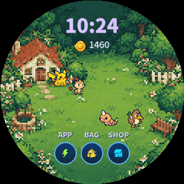
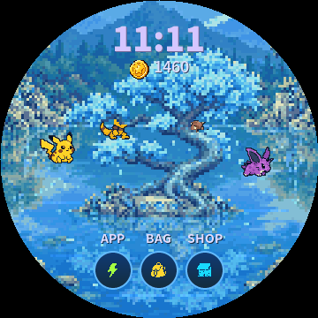
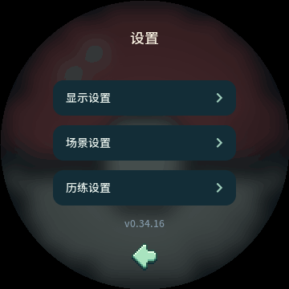
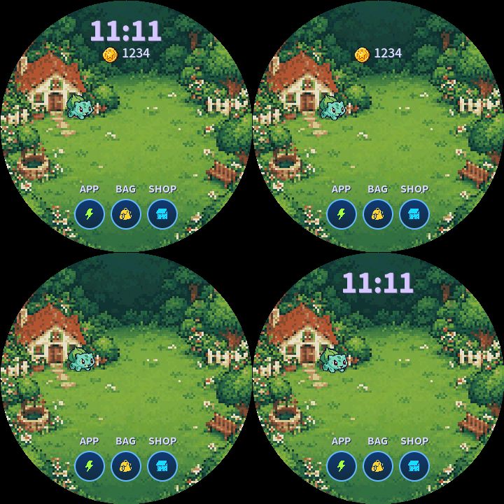
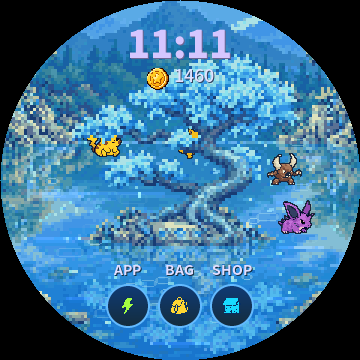

# 360×360 圆屏排版

| 层级 / 元素 | 尺寸 | 规则 |
|---|---|---|
| 主屏时间 | 36px / 900字重 | 浅紫色，独立数字字库 |
| 页面标题 / 当前技能 | 18px | 避免与辅助信息争抢视觉重心 |
| 名称 / 按钮 / 正文 | 14px | 一至两行短句，数值与单位分清 |
| 阶段 / HP数字 / 属性 / 主屏入口 | 12px | 降低辅助信息大小，保证可读性 |
| 主屏宠物 | 40×40 | 20px原生网格，最近邻放大 |
| 菜单图标 | 24×24 | 卡内不与标签相叠 |
| 道具图标 | 32×32 | 左图右文，不缩放读取的图片 |
| 主屏圆按钮 | 44×44 | 图标24px，标签在按钮上方 |

主屏仅保留时间、金币、短气泡和三个入口。标题/数值使用深浅对比，避免繁复背景下消失。

挑战页面纵向分为标题、阶段、双方名称、HP、战场、当前招式、底部操作。战场内只放宠物、技能和浮动伤害；不将战斗长句塞入底部。辅助标签与血条留出间隔，不用负坐标把文字藏进父容器边缘。正常战斗返回按钮居中，结算后返回/再来成对排列。

更新后运行 tools/capture_preview.py，查看所有页面、四种技能GIF及手机网页。电脑预览采用相同的LVGL界面；实机刷新耗时仍需上板验证。
# 0.4.0 细化

2026-10-22 参考宠物截图整理：原生画布改40px，主体32px以内，不再先压成16px再放大。压短下身、简化为12色并保留眼睛高光，动作以1px变化播放。原图仍为已有MobiIoT四姿态，参考编辑6次HTTP400未成功；未冒充新画稿。历史预览已归档至dist/archive/unused-art-before-001-template-20261023.zip（原路径screenshots/pets-reference-v5.gif），以下20px规格为前版记录。

移除外扩深色轮廓，仅对原遮罩内部的深色边缘使用本体色，保留眼睛。维持20px原生网格和40px画布。状态页增加等级、经验细条；挑战准备页显示2×2技能标签，战斗显示当前技能槽。内页和按钮使用低对比竖向渐变、细边框与按下反馈。进化等级、光环、新形态名与按钮保留独立间距。

## v0.5.0参考庭院与首次选择

- 首次选择页：顶部短标题，3张84×114卡片，001/004/007的48px新像素图，当前名称与单个确认按钮。确认前不修改宠物；首次选定后立即请求存档。
- 庭院：主场景为MobiIoT参考实拍图生成，120×120网格最近邻3倍，24色，浅薄荷中心和边缘小景物。时间/金币保留，底部3个圆按钮与短标签有局部文字衬底，无大型暗色面板。
- 宠物48px画布、38px主体；20秒巡游周期，14.4秒走动、5.6秒休息，移动约88×68px，左右镜像朝向，按住时停止位置更新便于长按。
- 对话初次延迟18秒，随后32–43秒间隔，持续2.8秒；跟随宠物头顶，靠近屏幕边缘时限制气泡位置，旅行/睡眠不发言。
- 背包、商店、状态页返回庭院。真机图片直接映射Flash，页面销毁重建不触发文件系统读取。其他11场景仅做原素材色彩整理，保留原主题。

## 四张实拍参考的比例调整

APP图标56×56、三列、标签12px，7项入口完整保留；底部36px圆形返回。挑战场景324×112放在(18,108)，HP位于其上，48px精灵在场景内，技能与最近两回合记录在下方。收藏中央8×8细网格、两侧无框箭头、顶部计数；暗点表示未接入独立图片的位置。截图是桌面共享LVGL渲染。

## Web同步（v0.5.0）

资源工坊圆屏增加庭院、APP、挑战、收藏、初选切换；APP和其他功能页引用共享LVGL截图，挑战播放技能GIF，页下注明固件画面预览。Web庭院使用同一20秒路线、48px动作及镜像、18秒首次气泡和32–43秒后续间隔；气泡2.8秒并跟随宠物。初选001/004/007只保存到浏览器，四宠同屏可切回演示，不影响设备存档。收藏独立图片未接入，保留暗点占位与10页预览。

## v0.5.1圆屏安全边距

时钟下移12px，页面标题y38；主屏底部三按钮上移13px，返回上移12px，初选/进化确认上移10px。挑战结算再来按钮缩为64×32并内移，历史记录与按钮分开。APP图标52px、行距72px，避免文字被下一行图标盖住；提示条缩为224px并上移。Web坐标、点击区、预览截图和GIF同步。

## v0.6.0庭院与计步器

庭院恢复最初草地/房屋背景，亮度提高6%。蛋随机2–4小时，旧长计时迁移时最多剩4小时，仍需摇动启动。APP第三排为挖宝与计步器。计步页面显示今日/累计步数、金币、每只宠物获得XP和下一个100步奖励档；仅更新数值与进度，不每步重建页面。Web入口、背景、截图、技能GIF、资源清单与固件同步，示例步数不能当作浏览器或设备的真实计步。

- v0.6.12宠物图鉴每页10张（3+4+3），40px宠物居于62px卡片，标题下方无计数；当前10形态仅一页，因此无页码与翻页按钮。

- v0.6.13商店/背包卡片两列x70/184、宽106，维持32px图标、14px文字，避免内容贴近圆屏侧缘。

- v0.6.14宠物图鉴图标换成32px红色电子图鉴机，蓝色扫描镜头、浅绿色屏幕，与其他APP图标保持一致。

- v0.6.15战斗背景360×112横向铺满圆屏可见宽度，场景轻微离线虚化，宠物/特效/文字保持原始清晰度。左右HP条延长到126px，靠近左右圆弧内侧，敌方从右侧填充，数字仍在安全区。

- v0.6.16仅战斗宠物放大25%为60px，双方中心x80/280，脚底y216；近邻关闭抗锯齿，技能轨迹和伤害跟随新中心。

- v0.6.17血条外端按圆弧切口接屏幕左右边缘，内端保留小圆角，满血与扣血均以可见部分计算长度。

- v0.7.1战斗宠物尺寸56px（原60px），保持左右中心80/280与画布脚底216；修复索引图变换造成的透明区域杂线，移除场景底部四段指示条，保留技能名称与出招方。

- v0.7.2三场景重绘：6水晶洞穴（蓝紫矿石）、11天空岛（浮岛遗迹）、3城镇（商铺广场），顶部深色构图保证HUD读数；原位替换、价格不变。

## 场景环境特效（2026-10-23）

12个场景都有间歇性像素粒子：庭院微风、樱花飘落、海风波光、城镇风叶、秋叶纷飞、雪地飘雪、水晶闪光、荧光孢子、流星星尘、沙漠流沙、阵雨、天空岛浮云。每分钟按50%–75%的场景概率触发，单次15–24秒，淡入淡出；雪地每分钟75%概率、持续24秒。

最多24粒子，位于宠物后方、不接受点击；避开上方时间金币、下方导航及圆屏外缘。Web与固件同算法，减少动态设置下Web不播放。预览见screenshots/ambient-scenes.png及ambient-5.gif；强制天气参数仅供验收。

## 战斗逐条播报（2026-10-23）

下方以无底板14px文字逐条显示出招、倒下与胜负，如“皮卡丘使用了电击”。每条停留1秒，再0.5秒上移16px淡出，然后显示下一条。取消旧技能卡与双行历史，形态名随进化变化，伤害保留场景数字。最后一条结束再显示再来按钮和允许自动进化。核心暂无麻痹等异常状态，播报不虚构触发。Web的28技能GIF同步，预览见screenshots/battle-narration.gif。

## 场景对比度（2026-10-23）

12场景的背景对比度统一降至原图处理结果的84%，让宠物轮廓更突出，整体亮度基本保持。庭院、旅行、战斗和场景缩略图一致，宠物、技能、文字及图标不做降对比处理。离线处理保留120px原生网格和48色上限，不增加帧循环处理。对比见screenshots/scene-contrast-comparison.png（左原效果，右调整后）。

## 进化动画与属性色（2026-10-23）

旧形态先聚集微粒，再在聚光中切换为新形态，随后颜色恢复、光环和粒子散去，名称与完成按钮柔和出现。去除原来的高频闪烁和粗硬效果；96px整数倍像素精灵、细环及低透明光晕保持画面留白。草绿、火橙、水蓝、虫黄绿、一般米色、毒紫、电金、地面沙色按主属性选择；标题、辉光、微粒和新形态名称统一配色。动画完成门槛仍2.2秒，进化提交和存档规则保持。Web详情使用最新共享UI进化GIF，参考screenshots/evolution-colors.png与evolution-2.gif。

## v0.9.2 导航名称与金币位置（2026-10-23）

庭院三个入口统一显示 APP、BAG、SHOP，对应页面标题同步。标签沿用16px粗体专用字库，宽度52px，中心和按钮保持一致。BAG与SHOP标题下方显示居中的金币图标和余额：标题y38、图标y68、余额y67，按实际数字宽度计算整体居中，商品卡片不变。Web庭院标签、点击区、页面名称和共享LVGL截图同步，缓存版本092-nav-labels。效果见screenshots/nav-bag-shop-v092.png。

## 旅行界面（2026-10-23）

背景与战斗一致，使用当前场景的360×112轻虚化横幅，在屏幕x0/y108左右铺满；前景宠物保持清晰。上方显示目的地、伙伴名和返程倒计时，下方三行分别显示当前动作、最近奇遇及返程可领金币/经验。每个主题有散步、观察、歇脚及对应奇遇描述，动作随旅途时间变化。

返程才显示领取按钮；领取后保留本次收获画面，展示实际收藏品品质/名称、金币和经验，再返回APP。旅途收入沿用原规则，途中的金币标记为待领取。Web可切换旅途中、已返程和收获三个共享固件预览状态，不改变浏览器收藏。画面见screenshots/travel-states.png。

## v0.9.3 · 伙伴与每日功能（2026-10-23）

详见 [操作与每日增益](DAILY-COMPANIONS.md)。APP移除挖宝，八入口热区重排；宠物状态页状态条18px行距，进化按钮y220，换伙伴/添伙伴按钮y260，候补6格/页，分页箭头与返回在圆屏安全区。设置增加开关，塔罗显示当前效果和当日有效提示。共享截图 `screenshots/daily-features.png`。

`tools/test.sh`包含ASan/UBSan迁移/候补/8种效果和Web日期状态；共享`--smoke`包含BOOT共用入口、真实指针换宠/设置/每日牌；全资源字库和16页RGB565圆屏外沿通过；ESP-IDF 0.9.3编译通过。Tabbit验证设置/抽牌重载、长按BOOT/宠物状态入口，390px/1440px无溢出或资源错误。未作本轮真机刷入和物理BOOT实测。日志`build/daily-*.log`。

## 庭院金币、时钟与导航（2026-10-23）

庭院金币使用24px图标和18px余额，按实际数字宽度连同4px间距整体居中；BAG/SHOP内16px金币保持原样。底部APP/BAG/SHOP采用14px粗体，文字顶部y259，下移6px，按钮位置保持。

用户已取消电池图标及设置页“电量数字”开关。时间从36px放大到38px，保持y35居中、900字重与淡紫/深紫阴影；金币位置保持足够间距，计步数字仍36px。

生产固件停止电量计初始化和轮询，不读取/写入旧电量偏好；既有NVS与浏览器键保留但不使用。Web同步移除电池和电量参数演示，缓存093-clock38保留并行后缀。共享时钟/设置画面见screenshots/home-hud.png、page-0.png和page-11.png。

## 首次相遇片头（2026-10-23）
首次进入且尚未选伙伴时，先播放 11.2 秒「草地初遇」（页面22）：001妙蛙种子从左侧走入、004小火龙随后到来、007杰尼龟从右下赶来；泡泡、火星与叶片依次打招呼，最后三只并排展示草/火/水图标与“一起开始冒险吧”。复用原生48px精灵/独立动作时长/左右朝向与庭院背景，固定18个轻量特效，33ms更新，无帧内文件读取、整只缩放或新图片资源。

下方 `>>` 随时跳过；结束或跳过进入既有页面13，确认前不授予宠物。独立 NVS `pokemon_plus/intro_seen` 在结束或跳过后保存，写入放在显示锁外，不更改游戏存档版本。未播完断电可重播；已看过但尚未选宠直接进入初选；已有伙伴的玩家直接进入庭院。

Web 同步时间线，使用独立 `pokemon-plus.web-intro-seen`；资源就绪后开始计时，支持少动态偏好（1.4秒静态欢迎），新增“片头”按钮供重看。重看不清除伙伴、图鉴或设备记录。预览见 `docs/screenshots/intro.gif`、`intro-storyboard.png`；此轮仅构建，未刷机、未更新发布ZIP。

片头标题与欢迎语采用24px/800字重（原18px/500）；英文标题y60、欢迎语y238，保持居中及圆屏留白。字库来源记录于assets/intro-font-source.json。

片头英文标题更新为两行：上行POKEMON 28px/y46，下行PLUS 24px/y80，两行居中、800字重；欢迎语保持24px/y238。

片头当前字号以32/24/20为准：POKEMON 32px/y44，PLUS 24px/y80，欢迎语20px/y242，三者均800字重；Web同步。

片头标题增加1px深色字形描边、左上高光及3px紫色侧面，配轻投影；欢迎语保持20px并增加轻浮雕。固定字形层直接绘制、无模糊，Web与固件同步。

## v0.20.4 · 孵化药剂

商店第七项替换为「孵化药剂 · 120」，购买仅增加背包库存，背包第七项显示数量。沿用32px药瓶图标；两页前六项统一为106×44、48px行距，第七项184×36置于(88,250)，底部返回保留独立间距。使用后完成场上已有的蛋，不要求摇蛋；无蛋不消耗，有蛋且总容量未满时可用。庭院满则新宠进入候补；购买工具不受宠物容量限制。普通蛋仍180金币、2–4小时。

Web同步共享商店／背包截图与道具资料，资源详情提供购买／放入演示蛋／使用流程，演示库存仅本次页面有效，独立于设备存档。

## Web场景特效演示

圆屏下方的特效栏显示当前特效图标及短名称；点击「播放特效」立即循环演示，使用左右箭头查看全部12场景。点击「停止演示」恢复随机触发；动作模板页也可叠加演示。此按钮仅控制浏览器预览，不修改设备设定。减少动态效果启用时默认无自动粒子，主动播放仍可查看。

## v0.20.5 · 扩大场景特效

环境粒子改为圆屏大范围分布，保护区域仅覆盖时间／金币和底部按钮；不再限制在130px高的中间带。水面波光与流沙依据地形安排，雪／叶／雨／孢子可延伸至上下与两侧。风叶使用阶梯形、雨使用两段细线并附地面小涟漪、流星带分级渐淡尾迹、云使用三层像素块；大小／速度／明暗分层，最多48粒。两端绘制使用相同规则；Web手动演示连续播放，关闭后保留自然触发。

## v0.22.2 · 局部场景动画

庭院背景默认持续播放，与随机天气分开：树冠绕固定下沿轻摆1个原生像素，水面沿行缓慢流动，水晶晶面呼吸加移动光带，蘑菇微光、实际星点闪烁、天空岛原有云海轻移。共45个独立相位区域；不移动房屋、地面、路径、树干或UI。HUD、导航和r171外像素受保护。

`assets/scene-motion.json`的多边形与颜色筛选对应原120px绘画；更换场景图后运行`python3 tools/prepare_scene_motion.py`并查看实际动图，输出C与Web相同的1308个行段掩码（v0.22.5精修后）。没有增加场景图片或整图动画帧。C纯函数`core/scene_motion.c`与Web RGB565采样一致，120ms检查一次；树冠静止阶段不要求重绘。固定316800字节PSRAM保存原生基底／输出与360px显示缓冲，仅更新发生变化的3×3像素块，描述符地址固定，不调用文件读取或帧内分配。若缓冲分配失败，保留静态场景。

Web庭院和动作模板共用局部动画，遵循`prefers-reduced-motion`；主动播放原有特效可覆盖减少动态偏好，停止恢复自然天气与系统偏好。场景动画不写存档、不调用游戏随机数。验证示例见`screenshots/scenery-motion.gif`。

## v0.22.5 · 逐景环境精修

| 场景 | 调整后的表现 |
| --- | --- |
| 清晨庭院 | 稀疏慢风叶，树冠连片色块轻摆 |
| 樱花小院 | 专用粉色像素花瓣，轻微横向回旋 |
| 晴日海岸 | 涟漪仅在真实水面，水纹慢速缓流 |
| 城镇 | 更少、更淡的街角风叶，建筑与道路固定 |
| 秋日木林 | 金／橙／棕叶片，快慢错开 |
| 雪落小镇 | 远小近大的三层雪，亮度和下落速度分层 |
| 水晶洞穴 | 星芒贴合晶簇，不同相位的低亮呼吸光 |
| 蘑菇秘境 | 蘑菇附近升起孢子，暖黄／嫩绿柔光 |
| 星空山丘 | 星尘与稀疏长尾流星限天空，避开树线 |
| 沙漠绿洲 | 沙路上的短小低亮沙尘，棕榈叶缓摆 |
| 雨中村庄 | 远近细雨，地面局部小涟漪 |
| 天空岛 | 薄雾贴合云海，低不透明度，往返无硬跳 |

粒子靠近HUD、导航和外沿逐渐淡出；中央宠物活动区再降低不透明度。自然事件概率与持续时间保持。9种像素图形复用48×3固定矩形池；本体45区域／1308行段／316800字节固定PSRAM保持，不添加整景帧、不在逐帧读取文件或分配内存。树冠保留静态外剪影，内部连片像素弯动，避免边缘擦除与重复残影。

最终场景导出后，先运行`python3 tools/prepare_scene_motion.py`，再运行`python3 tools/prepare_scene_effects.py`；后者从实际绘画与运动掩码提取水面／晶簇／蘑菇／天空等锚点（每景最多96点），同时生成C和Web配置。完整`prepare_assets.py`末尾已串联两步。源配方不含派生锚点，修改场景画稿后需要重新生成并目视实际动图。

12景动态对照见`screenshots/scene-effects-refined.gif`，Web桌面与手机图为`scene-effects-refined-web-desktop.png`／`scene-effects-refined-web-mobile.png`。遵循减少动态偏好，显式播放允许演示，停止后恢复偏好。

## v0.22.6 · 宠物信息与换宠图标

长按场景宠物约1秒先看该个体信息；信息页下方36×36px双向箭头图标才进入候补选择，选中后立即回场景。取消候补选择返回信息页，未选择时不交换；长按后滑动松手不误触。像素箭头为固定界面图元，C与Web共用相同坐标形状，无新增位图或帧内读图。添伙伴仍为独立入口。预览见`screenshots/pet-swap-info.png`，完整交互见`PET-INFO.md`。

## v0.22.8 · 宠物信息排版

身份卡片(64,76,232,68)：原生48px宠物置于52px圆角底座，名字18px，等级与经验12px，经验条136×4。五项照料按45px列距排列，复用24px树果／肥皂／药剂／球／闪电图标，标签12px、数值14px、32×4短进度条；暖黄／蓝／粉／紫／浅金分别区分属性，低于25用红色提示。进化按钮(94,230,172,32)使用低对比金色，换宠／返回／添伙伴图标分别位于x110／162／214、y286，均36px，最后一项仅庭院未满时显示。无新增位图或帧内读图／缩放，长按与换宠原流程保持；Web以预设值演示同版式。共享page-4和总览已更新，见`screenshots/pet-profile-info.png`。

## v0.27.2 · 右侧浮动提示

所有 `notice/pp_ui_notice` 共用一个常驻顶层提示，照料、购物、背包、旅行奖励、操作失败和存储提示统一。14px字、左右12px／上下8px留白、深绿圆角底；右边缘x320，文本测量后宽40–244px，最多220px正文自动换行。初始中心y210，3.2秒缓缓上移36px，前180ms淡入、最后960ms淡出；多行按高度居中，避免圆屏侧边裁切。新提示替换当前文本并重新计时，切页保留，不阻挡触摸；单个LVGL对象和静态文字缓冲复用，隐藏时暂停独立33ms定时器。

Web所有toast也改为屏幕右侧、自适应宽、同样上移淡出；使用manual popover顶层保证详情弹窗内也可见。窄屏保留20px边距，长句换行；减少动态效果偏好下只淡入淡出。宠物跟随气泡和战斗叙述继续使用各自专用布局。

## v0.29.1 · 场景特效可见度

12景采用持续基础层＋随机增强层。进入800ms内淡入基础风叶／花瓣／水纹／冰面闪光／晶芒／萤火／星光／沙粒／地面涟漪／云雾。天气每45秒独立判定，1.2–4.2秒后渐强，持续30–40秒，进出各1.2秒；雪与雨的静态基础层是冰闪与涟漪，降雪和落雨只在随机天气期间出现。两层共用连续时间轴，密度和透明度渐变，避免重置轨迹。

粒子池仍48×3固定图元；风叶／花瓣6–8px，雪花远中近3／4／7px，雨丝3×14–21px，晶芒7／9px，萤火7／9px带柔光，水纹9–12px，云雾16–24px。水纹锚定真实水面、晶芒锚定晶簇；天空岛从单侧9个云雾锚点扩展为两侧38个。树冠周期缩为原72%，水面高光／晶体呼吸／云海流动加强，保留原画轮廓及岸线。仍排除HUD (80,22,200,90)、底部导航(98,258,164,70)及r172之外区域，靠近边界提前淡出，宠物绘制于特效上层。

C与Web共享生成配方和物体锚点，Web保留“播放特效”强制演示和减少动态效果选项。`--scene-fx-off`用于实际渲染对照；不修改场景切换／随机场景／游戏RNG／存档。预览见`screenshots/scene-effects-visible.gif`和全部12景`screenshots/scene-effects-refined.gif`。

## v0.29.2 · 全圆屏雨雪

雪落小镇与雨中村庄的实际降水取消y108–296中段限制。40个降水粒子采用408px连续轨迹，y−24至383，均匀错开初始相位、横向覆盖0–359；8个冰面闪光／地面涟漪仍保留原材质锚点。降水穿过时间、金币及底部导航的背景，不再使用HUD／导航矩形排除区或其14px渐隐；文字、宠物和按钮绘制在降水上方。其他场景的材质点缀继续遵守原HUD／导航保护区。

降水仅在r176内绘制，最后6px柔和渐隐，避免产生泛白外圈；原静态背景继续铺到实际面板边缘。粒子池48×3、概率天气／随机周期／存档／场景原画保持，Web与C整数结果一致。查看`screenshots/weather-fullscreen.gif`（真实共享渲染器，两个场景各40帧）。

## v0.29.3 · 其余十景动效

庭院／樱花／城镇／秋林采用408px错开相位的全屏轨迹，远中近4／6／8px，花瓣与落叶随扑动改变轮廓；城镇三分之二为轻风尘点，余下落叶。蘑菇秘境萤火从底部外沿向上漂，5／7／9px柔光随呼吸闪灭，不再每72px跳回起点。所有空气特效取消HUD／导航矩形空洞，图层仍位于文字／宠物／按钮之下。

海岸波纹9–12px呼吸扩散、四分之一为3／5px水光；水面锚点从原画材质多边形直接提取，不能复用已挖HUD空洞的运动遮罩。晶簇5／7／9px蓝／紫／青星芒，星空3／5px呼吸星点与28×11px流星（仍不越过y138树线）；风沙以2–4px沙粒配少量10px风丝，云海22–32px薄雾平滑往返。水纹、晶光、沙粒、云雾以各自材质为锚点。

原weather标记泛化为full_screen，非降水十景均按r176／最后6px淡出，替代先前十景挖界面空洞的规则；雪／雨的运动、触发概率和静态层保持v0.29.2。池仍48×3，配方／材质颜色门限分别由assets/scene-effects.json及tools/scene_materials.py维护，后者与底图运动生成器共享，原45特征／1308行段逐字节不变。Web缓存scene-fx6／ambientfull2；预览见screenshots/scene-effects-refined.gif。

## 星空山丘流星与枫叶（2026-10-24 更正）

按用户更正，流星归属星空山丘（scene8），庭院（scene0）恢复绿色风叶。星丘kind9共36个槽位：前8个为错开的流星，后28个为原画天空锚点上的3／5px呼吸星点。流星40×16px，七段渐亮淡蓝／淡紫拖尾与亮头，每条3.2秒，10秒周期，200ms淡入／400ms淡出；整个流星下缘不超过y138，位于山丘与树线之后的天空。背景之上、宠物／HUD／气泡／按钮之下，保留圆边淡出。

秋日木林保持七块连接的红／橙／金枫叶，中央叶尖、侧瓣、收窄叶身与叶柄清楚可辨，保留全圆屏飘落。固定对象仅在进页创建：星丘36×7、秋林48×7、庭院40×3。C与Web整数轨迹一致；帧内不创建对象或读图。screenshots/comet-maple.gif、12景总览和Web scene-fx8／skycomet1缓存同步；本次不改变全局版本与存档。

## 神树镜湖（第13景）
白天的天蓝色神树采用不对称樱花树形，根系缠绕祭坛。宠物沿镜湖24秒绕行一圈，后方被树冠／树干／祭坛遮挡，前方完整显示；枝下透明空隙保留。道具和蛋沿湖岸摆放，宠物取食绕开祭坛。蓝叶落水产生涟漪，树冠摇曳与水流使用原生像素材质动画。Web预览和共享LVGL遵守同一深度规则。

### 2026-10-25 场景留白
主屏时钟y29、金币文字y66／图标y67；底部标签y265、圆按钮y284／中心306。相对旧版时钟上移6px，金币上移12px（与时钟缩短6px），底部标签与按钮整体下移6px。Web绘制与热点同步，原字体／图标尺寸保留。

### 2026-10-25 特效触发概率
13景统一每45秒一轮、30%触发；未触发不显示粒子。树冠、水面等基础材质动画持续运行；Web「播放特效」可强制演示，停止后恢复概率。此前神树等场景的100%触发说明由此覆盖。

### 设置 Switch（2026-10-25）

仅显示每日随机场景、显示时间、显示金币三项，时间金币默认开启，独立持久化。整行和滑块都可点击，薄荷绿表示开启、灰蓝表示关闭，160ms滑动。三行228×48，位于(66,94/154/214)。设备采用独立NVS偏好，Web采用浏览器设置。

### 神树造型与远山层次（2026-10-25）

神树采用 MobiIoT 第09稿，参考用户提供的盘曲樱树：粗壮S形树干、向左横伸的枝条、右上方主冠与分层的小树冠，保留天蓝色、根缠祭坛和两侧镜湖活动区。背景由近处树林、中景蓝色山脊、浅色远山分层。独立枝层之间保留透明空隙，宠物从树后经过时按实际轮廓遮挡。树冠、树干和水面采用独立掩膜，避免远山摇动、树干流动或树上出现水纹。时间、金币置于树前景之上；Web与共享LVGL同步。

穿模修正：补齐右侧蓝叶与裸露分叉的逐像素遮挡。巡游保持24秒，改为12段，沿两侧先走到祭坛前方，再横向通过，避免斜切外扩树根；脚底达到y254才置前。取食按13px脚底接触宽度绕行，随机道具／蛋同步移至更外侧湖岸，枝间水面仍透明。

### 水晶洞穴：晶光蝠影（2026-10-26）
场景6的蝙蝠随既有30%特效事件出现，不属于常驻景物。36个晶簇闪光槽和8个蝙蝠槽共用44粒子池；事件中每14秒分批拍翼掠过，远近两层17×11／23×15px、上拍／平展／下拍三姿态，保留宠物与HUD前景。每只由7个固定矩形组成，入场预建，不增加帧内读图／创建。Web「晶光蝠影／播放特效」可强制演示，停止后恢复正常概率。共享LVGL动画见screenshots/cave-bats.gif。

### 沙漠绿洲：风沙滚草（2026-10-26）
风滚草仅随30%特效事件出现，与37个沙粒／风丝槽共用40粒子容量。三只错峰滚过沙地，8帧旋转、轻微弹跳，在宠物和HUD下层。用户要求明显像素感：最终使用MobiIoT第二稿，4色＋真实透明，16／18／20原始网格旋转后最近邻2倍，输出32／36／40px原生图，不做帧内缩放。启动常驻24帧描述符，场景入口预建3个image对象；保留风沙，不使用矩形替代球。Web同源PNG与共享LVGL动画已同步。预览screenshots/oasis-tumbleweed.gif，帧表screenshots/oasis-tumbleweed-frames.png。

### 天空岛：浮云逐风（2026-10-26）
触发云从细薄横条改为七块构成的三瓣像素云团，40／60／80px宽，采用2／3／4px统一块网格；远淡蓝／中浅蓝白／近暖白三层，半透明云底。每秒14–34px持续横向飘过并轻浮动，y≥94避开时间／金币；位于宠物及UI下层。12云槽、84个固定图元，无帧内分配或读图。仅既有30%事件触发后显示，Web“浮云逐风／播放特效”可演示。共享画面screenshots/sky-clouds.gif及13景总览已更新。

## v0.33.42 · 神树精华与道具九宫格

商店新增200金币神树精华，五项状态恢复到100。商店／普通背包改为3×3卡片，72×62px、x64/144/224、y102/168/234；背包只显示图标和数量，商店显示图标、名称和价格。神兽蛋3＋2居中、无名称。覆盖此前两列道具布局，详见[道具规则](ITEMS.md)和[菜单布局](MENU_UI.md)。
